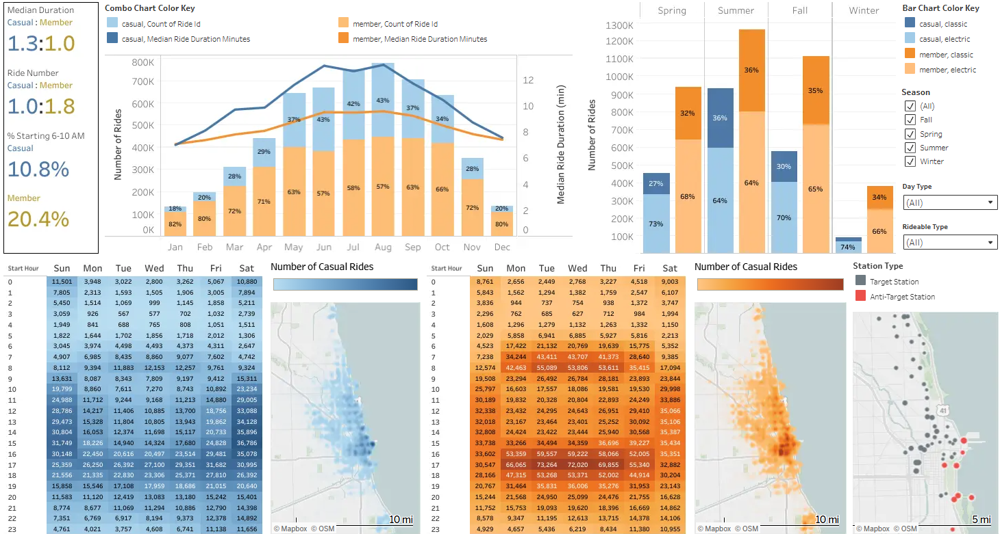
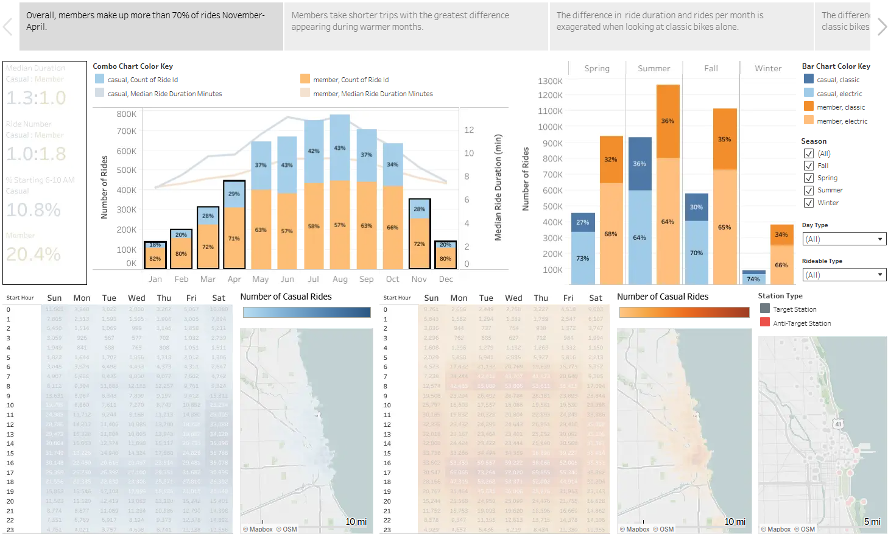

# Ride-Share-Membership-Growth-Marketing-Analysis

A project focused on identifying differences between members and casual users in order to convert casuals into members.

## Executive Summary and Key Business Findings

- **Behavioral Segmentation:** Isolated three core differentiators that separate annual members from casual riders: **trip duration** (shorter, utility-driven vs longer, recreational rides), **temporal usage** (weekday rush hour vs weekend surges), and **seasonal resilience**.
- **Geospatial Marketing Optimization:** Identified **47 target stations** where high casual rider volume (**>10,000 annual rides**) overlaps with high member:casual ratio (**>1.2 member rides for every casual ride**) to maximize marketing ROI, filtering out 9 tourist dominated anti-target stations.
- **Biphasic Campaign Strategy:** Designed a go-to-market strategy targeting **peak volume acquisition (May-August)**, when >80% of casual rides occur, and **targeted conversion (December-February)**, when a low volume of casual riders closely mirror member usage behaviors and shift towards e-bike reliance (1:3 ratio).
- **Pricing Breakeven and Loss Aversion Triggers:** Quantified exact profit thresholds (**3-4 classic rides/month** or **2-3 electric rides/month**) to guide development of **in-app loss aversion triggers** and a **heuristic behavioral scoring framework** for personalized trial discounts.

## Background
A bike-share company operates a fleet of several thousand geotracked bicycles across a network of stations spread throughout Chicago. The director of marketing believes the company’s future success depends on maximizing the number of annual memberships. Therefore, we need to understand how casual riders and members use bikes to design a new marketing strategy for converting casual riders into annual members.

## Business Task
Accelerate revenue and annual membership growth by analyzing aggregate trip metrics to discover distinct usage patterns for casual riders and annual members, equipping marketing teams with data-supported profiles needed to optimize conversion campaigns.

### Key Objectives
1) **Develop Behavioral Profiles**: Segment ride data to isolate casual use that mirrors member behavior.
2) **Optimize Campaign Timing**: Pinpoint high-yield seasonal windows for aggressive marketing by mapping fluctuations in ride volume.
3) **Locate Geographic Hotspots**: Identify high-density stations for high-ROI out-of-home (OOH) advertisements.
4) **Define Conversion Triggers**: Translate clear cost-benefit metrics to establish where annual membership becomes more economical.

## Data and Methodology

### Data Source

The [raw data source](https://divvy-tripdata.s3.amazonaws.com/index.html), stripped of personal identifying information, is publicly available where Divvy, the real-world counterpart to the fictional company, publishes their records from June 1, 2020 to present. It is available through Motivate International Inc. under this [license](https://divvybikes.com/data-license-agreement). The raw data used in this project specifically is also available in a zipped format through this [link](https://drive.google.com/file/d/1q8HdW4d1rjG7KzZewwB8Yb_bmbnobJtk/view?usp=sharing).

### Primary Tools

- Google BigQuery (SQL): Utilized as the primary cloud data warehouse to aggregate, clean, and query historical transactional logs.
- Tableau Public: Employed to build interactive charts, dashboards, and executive storyboards.

### Secondary Tools

- Python: Utilized locally for raw data preprocessing (chunking for file resizing) to optimize cloud data warehouse upload efficiency.
- Markdown: Used to document the analytical log and maintain tracking notes.
- Google Sheets: Examining distinct station id/name combinations and organizing markdown tables.

## Data Cleaning

The executable queries are located in the [/scripts_and_queries/02_data_cleaning.sql](./scripts_and_queries/02_data_cleaning.sql) file. The results and thought process can be found in the [/notebooks/analytical-log.md](https://github.com/william-rivers/Ride-Share-Membership-Growth-Marketing-Analysis/blob/main/notebooks/analytical-log.md#step-3-process) file.

### Core Data Quality Operations

1) [Deduplication](https://github.com/william-rivers/Ride-Share-Membership-Growth-Marketing-Analysis/blob/main/notebooks/analytical-log.md#33-removing-duplicate-rides): Identified and removed using GROUP BY and HAVING
2) [Resolved Incomplete Records](https://github.com/william-rivers/Ride-Share-Membership-Growth-Marketing-Analysis/blob/main/notebooks/analytical-log.md#35-cleaning-station-id-station-name-latitude-and-longitude): Filled several thousand null station names and ids with the nearest station within 50 meters
3) [Verified Data Sanity](https://github.com/william-rivers/Ride-Share-Membership-Growth-Marketing-Analysis/blob/main/notebooks/analytical-log.md#35-cleaning-station-id-station-name-latitude-and-longitude):
   - Removed rides with negative durations or zero duration
   - Removed rides with 0-2 min durations if they did not travel at least 50 meters or change stations
   - Removed classic bike rides that averaged more than 8.5 meters per second (19.0 mph)
   - Removed electric bike rides that averaged more than 11 meters per second (24.6 mph)

## Analysis

The executable queries are located in the [/scripts_and_queries/03_business_analysis.sql](./scripts_and_queries/03_business_analysis.sql) file. The results and thought process can be found in the [/notebooks/analytical-log.md](https://github.com/william-rivers/Ride-Share-Membership-Growth-Marketing-Analysis/blob/main/notebooks/analytical-log.md#step-4-analyze) file.

### Primary Focus

Rather than deploying a broad marketing campaign across the entire casual footprint, this analysis focuses on identifying casual rides whose usage patterns already mimic the more utility-driven member behaviors. Targeting these low-friction conversions maximizes campaign efficiency.

### Behavioral Profiles

**Members**
1) Ride Duration: Lower average than casuals year-long
   - Greatest difference with casuals between May and September
   - More consistent difference on classic bikes
   - Longer duration than casuals on electric bikes during Winter
2) Season: Higher proportion of the rides between November and April
    - Most exaggerated during Winter (~80% of monthly rides)
    - Doubly true when looking at only classic bike rides or only weekdays
3) Day Type: Favor weekdays more than weekends
   - Especially high usage during traditional rush hours (6:00 AM - 10:00 AM and 3:00 PM - 7:00 PM)
4) Geography: Rides tend to be more spread out across the full service range
   - Especially true on weekends
   - Favor inland locations more than casuals
   - [47 target stations](https://github.com/william-rivers/Ride-Share-Membership-Growth-Marketing-Analysis/blob/main/notebooks/analytical-log.md#46-popular-station-analysis) identified based on volume and member:casual ratio
5) Overall: Very little variation in usage patterns

**Casuals**
1) Ride Duration: Higher average year-long
   - Duration rapidly increases as weather warms and rapidly drops as weather cools
2) Season: Higher proportion of the rides between May and October
   - Shift toward using electric bikes more often during Winter
3) Day Type: Favor weekends over weekdays
   - Weekdays only show rides clustered during the evening rush hour (3:00 PM - 7:00 PM)
   - Classic bike usage roughly doubles on weekends
4) Geography: Rides tend to be more concentrated in the same geographic area
   - Coastal areas in particular are highly popular
   - 9 anti-target stations identified based on volume and casual:member ratio
6) Overall: Large amounts of variation in usage pattern based on many factors

### Low Friction Target Segments

1) **The Short-Duration Commuters:** Annual members heavily favor taking short-duration, utility-driven rides. A significant cohort of casual riders mirrors this behavior, which marks them as likely converts.
2) **The Rush-Hour Commuters:** Temporal analysis shows that although the highest casual usage is on the weekends, a distinct segment of casual rides occur during traditional weekday rush hours (6:00 AM - 10:00 AM and 3:00 PM - 7:00 PM), matching member peak usage hours. The member-dominated morning rush identifies likely converts and the shared evening rush captures the highest traffic periods.
3) **The Inland Corridor:** Geographic mapping isolates a divide between members and casual users: casual rides concentrate more heavily along the coast while member rides concentrate more heavily inland. Analysis identified [47 stations](https://github.com/william-rivers/Ride-Share-Membership-Growth-Marketing-Analysis/blob/main/notebooks/analytical-log.md#46-popular-station-analysis) that are member-dominated despite high popularity with casual users.
4) **The Seasonal Pivot:** Casual riders still active during winter months (December-February) are displaying member-like behavior since casual rides dropped to 1/10th of their peak usage during the winter months while member rides only dropped to 1/4th of their peak. Additionally, while the rest of the year matches the standard member ratio of 1:2 classic-to-electric rides, winter casual usage shifts to a 1:3 ratio. This indicates a high willingness to pay a premium for speed and cold-weather convenience.

### Campaign Timing

Peak volume among both annual members and casual users occurs May-October with over 70% of all rides and over 80% of casual rides happening during this window. The number of rides per month starts to fall in September but doesn't drop below 600,000 rides until November. This is an optimal time for broad reach.

The extreme drop in casual usage during the winter months identifies a lower volume but also lower friction segment for targeted marketing.

### Conversion Triggers

**Membership Annual Profit Point**
| Ride Duration | Single, classic | Single, electric | Day Pass, both  |
|:-------------:|:---------------:|:----------------:|:---------------:|
| 10 min        | 48 rides/year   | 27 rides/year    | 8 passes/year   |
| 15 min        | 36 rides/year   | 19 rides/year    | 8 passes/year   |

**Membership Monthly Profit Point**
| Ride Duration | Single, classic | Single, electric | Day Pass, both  |
|:-------------:|:---------------:|:----------------:|:---------------:|
| 10 min        | 4 rides/month   | 3 rides/month    | <1 pass/month   |
| 15 min        | 3 rides/month   | 2 rides/month    | <1 pass/month   |

## Supporting Visualizations

### Dashboard

  
   
  <em>Figure 1: Interactive Member Conversion Dashboard. Click the preview image to open the live view on Tableau Public.</em>

### Story

  
   
  <em>Figure 2: Interactive Member Conversion Story. Click the preview image to open the live view on Tableau Public.</em>

## Recommendations

### Biphasic Go-To-Market Campaign

 - **Phase 1: Peak-Volume Acquisition (May-August)**
   - **Objective:** Capture the massive summer surge of casual riders by separating high-utility riders from recreational users.
 - **Phase 2: High-Conversion Retention (December-February)** 
   - **Objective:** Capture the lower volume of casual users who display the strongest baseline alignment with annual member habits.

#### Implement In-App Loss Aversion Triggers

At the end of each qualifying ride (aligned with member behavior), display loss aversion triggers to prompt thought about the value proposition represented by the membership. The annual membership breaks even with single ride use at a very low number of rides per month. This information needs to be presented in an easy to interpret format so that casual users can easily identify the value of an annual membership without any calculations or logical thinking.

-  **General:** A membership would have saved you $X.XX on this ride
-  **General:** This month you would have saved $X.XX with a membership
-  **General:** Did you know the annual membership costs less than $12/month?
-  **Shorter Classic Rides:** Membership costs less per month than four 10 minute rides/month on classic bikes
-  **Longer Classic Rides:** Membership costs less per month than three 15 minute rides/month on classic bikes
-  **Shorter Electric Rides:** Membership costs less per month than three 10 minute rides/month on electric bikes
-  **Longer Electric Rides:** Membership costs less per month than two 15 minute rides/month on electric bikes
-  **Day Passes:** Did you know the annual membership costs less than 8 Day Passes?
-  **Classic Ride Under 45 Minutes:** This ride would be free with a membership!

#### Deploy Localized Out-of-Home (OOH) Station Marketing

Establish localized brand equity by deploying physical marketing (e.g. vinyl station wraps, dock signage, or digital terminal displays) at the 47 key stations identified during the analysis. These advertisements should be focused on the annual membership's value at even low volume and the citywide coverage.

### Offer Dynamic Membership Trial Discounts

Establish a system to identify casual users most likely to convert (most utility-driving rides) and lower their barrier to conversion by offering a short discounted trial. A special consideration for the winter phase is that people often chose new habits or goals at the start of the new year. Lowering the barrier to entry encourages people to trial a healthy mode of transportation or exercise at a time that  they may be searching for exactly that.

**Example Heuristic Framework (Baseline for A/B Testing)**
Points earned per ride and aggregated over the month

- Ride Duration
   - Duration > 45 minutes: -3 pt
   - 25 minutes < duration <= 45 minutes: -1.5 pt
   - 15 minutes < duration <= 25 minutes: 0.0 pt
   - 10 minutes < duration <= 15 minutes: +1.0 pt
   - Duration <= 10 minutes: +2.0 pt
- Season
   - November, March, or April: +1.0 pt
   - December, January, or February: +2.0 pt
   - May-September and duration < 10 minutes: +1.0 pt
   - May-September and weekend: -0.5
- Day Type
   - Weekday and 7-9 a.m. start: +2.0 pt
   - Weekday and (6-7 a.m. or 9-10 a.m. start): +1.5 pt
   - Weekday and 3-7 p.m. start: +1.0 pt
   - Weekday and other time: +0.5 pt
   - Weekend: 0.0 pt
- Rideable Type
   - November-April and electric: +1.0 pt
- Geography
   - Starts at a target station: +1.5 pt
   - Ends at a target station: +1.5 pt
   - Starts at an anti-target station: -1.5 pt
   - Ends at an anti-target station: -1.5 pt
   - Start station = end station: -2.0 pt
- Consistency (tracking individuals' behavior)
   - 2-3 rides/month and avg pts >+ 3.0: 1.5x points
   - 4+ rides/month and avg pts >+ 3.0: 2x points

**Monthly Points**

<6 points: No trial month offered
   - Low conversion probability
   - Tourists and low utility

6-14 points: 25% discount on 1 month trial membership ($8.99 for the month)
   - Moderate conversion probability
   - Errand runners and occasional commuters
   - Captures a high-volume segment likely to save with a membership

15+ points: 50% discount on 1 month trial membership ($6.00 for the month)
   - High conversion probability
   - Frequent users and commuters
   - Captures high-alignment segment in need of a membership

Additional analysis is needed to identify whether this promotion should be limited to the winter phase. If the high volume of casual summer rides represents repeat customers, it could lead to a notable drop in summer revenue from casuals using the discounted trial without intending to purchase an annual membership. If the high volume is mostly from unique users, the promotion is unlikely to affect revenue severely.

### Limitations

* No Customer IDs or Conversion Flags: The dataset lacks the unique customer IDs required to track individuals longitudinal usage or conversion flags to identify a casual that later purchased a membership.
* No Demographic Data:  The dataset lacks the demographic profiles required to track cohorts of users.
* Financial Redaction: The dataset lacks exact pricing tables, dynamic surge rates, and operational costs required to determine a precise ROI forecast for the campaign.

### Next Steps

1) User Tracking: Identify whether high summer casual usage is driven by repeat users or unique users
2) A/B Testing: Launch a small-scale pilot of the in-app loss aversion triggers to test conversion lift before global deployment.
3) First-Party Surveys: Deploy brief, incentivized in-app surveys to better understand blocks preventing membership acquisition.
   - Example Incentive: One ride at membership pricing
4) Use k-means clustering, random forest, or related machine learning concepts to optimize the algorithm for identifying likely converts
   - Planned future data science addendum

*This project dataset was suggested by the Google Data Analytics Certificate as part of the capstone project.
