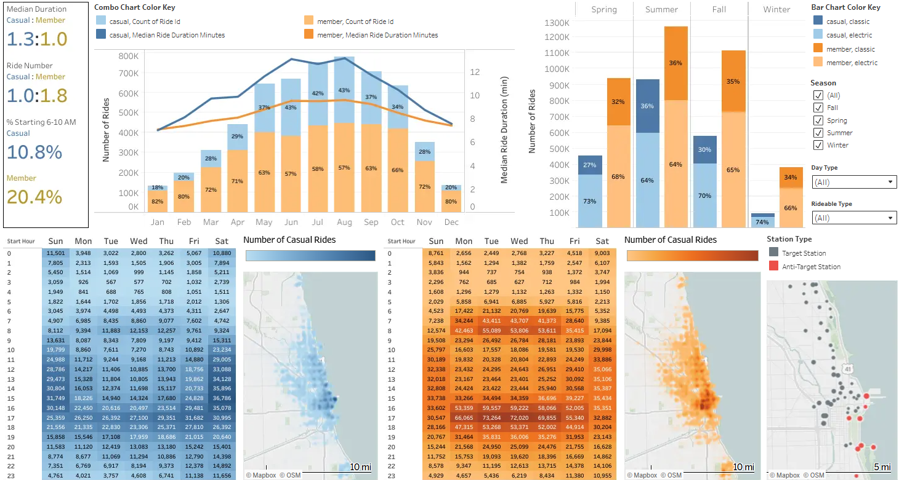
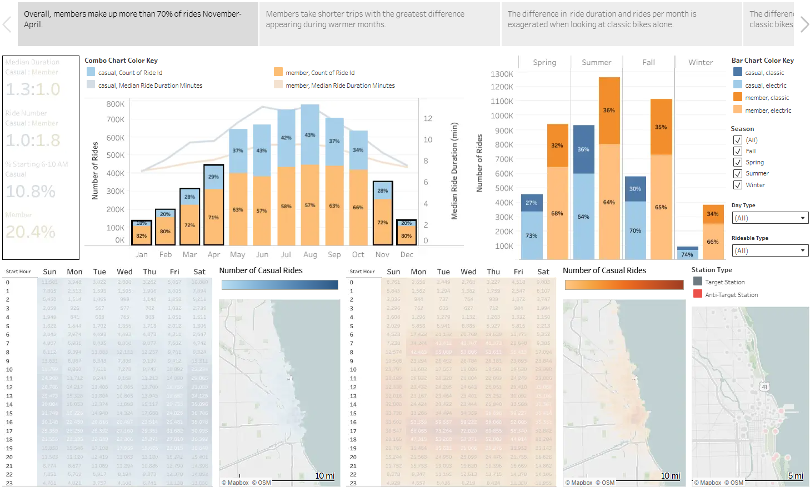
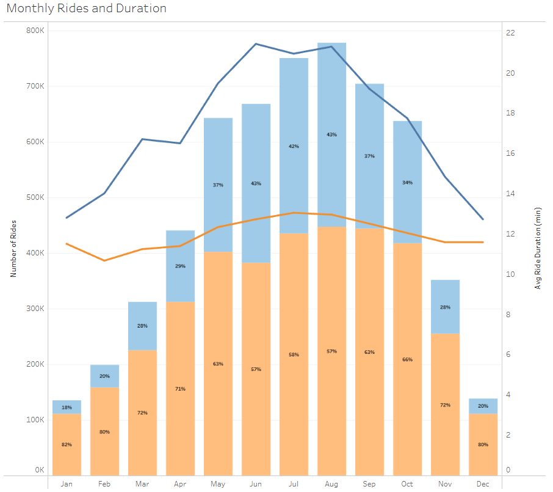
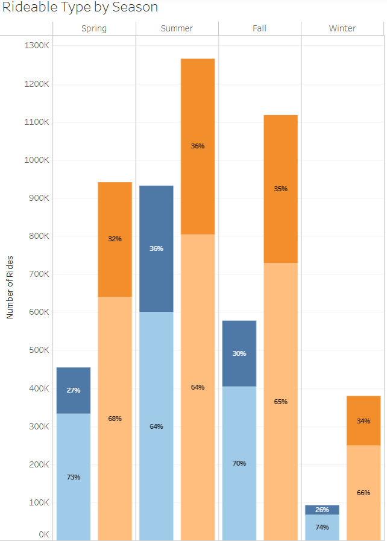
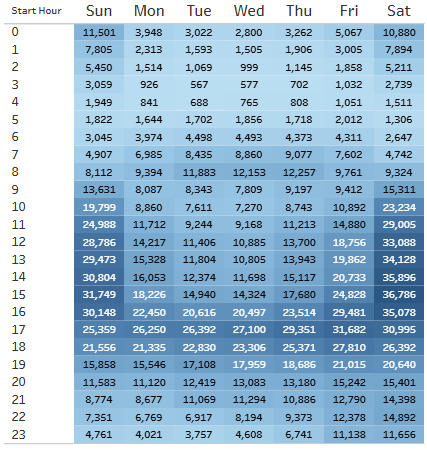
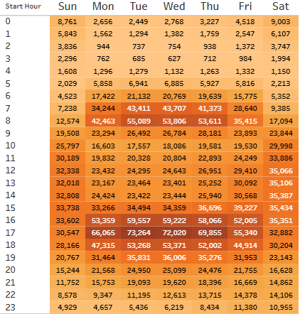
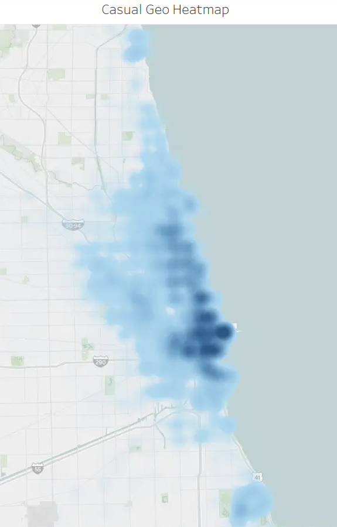
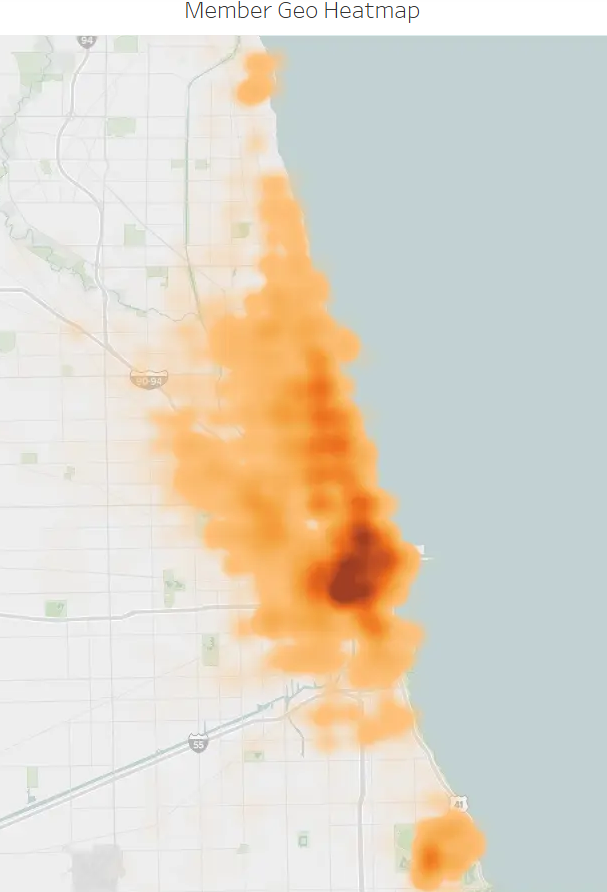
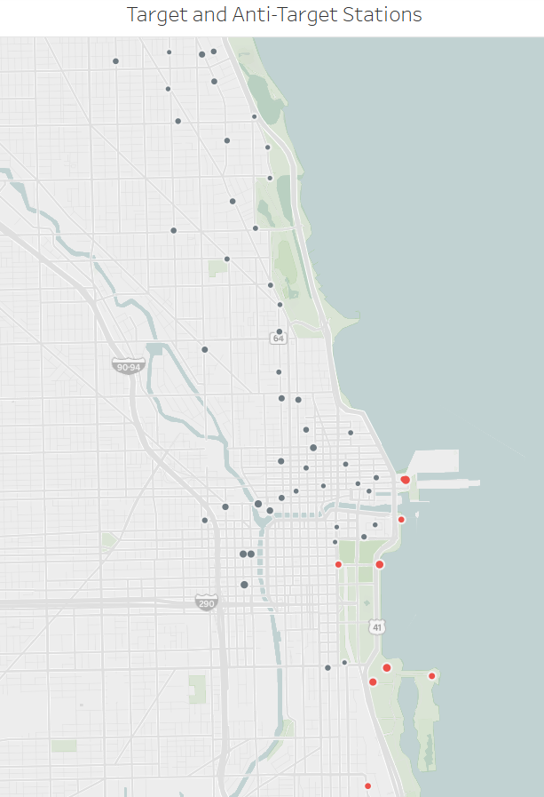
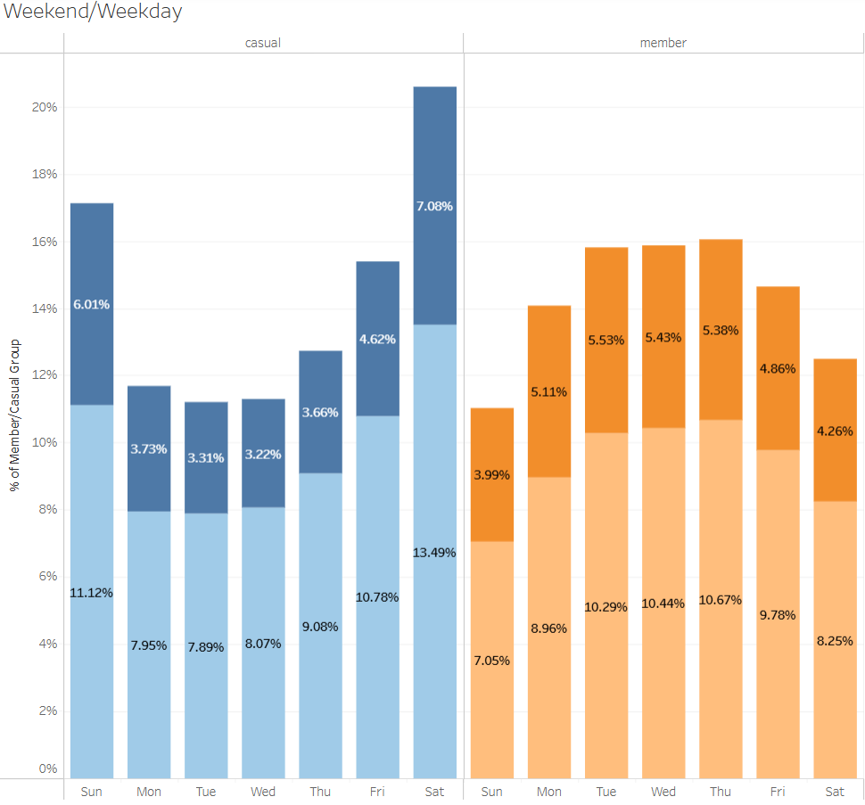

## Introduction

All visualizations are saved in the same workbook, so they can all be accessed from any of the links. Each visualization is directly linked below for your convenience.

## Dashboard

  
   
  <em>Figure 1: Interactive Member Conversion Dashboard. Click the preview image to open the live view on Tableau Public.</em>

## Story

  
   
  <em>Figure 2: Interactive Member Conversion Story. Click the preview image to open the live view on Tableau Public.</em>

## Individual Charts

### Monthly Rides and Duration

  
   
  <em>Figure 3: Interactive Combo Chart of Rides and Duration. Click the preview image to open the live view on Tableau Public.</em>

### Rideable Type by Season

  
   
  <em>Figure 4: Interactive Stacked Bar Chart of Rideable Type by Season. Click the preview image to open the live view on Tableau Public.</em>

### Casual Time Heatmap

  
   
  <em>Figure 5: Interactive Heatmap of Casual Times. Click the preview image to open the live view on Tableau Public.</em>

### Member Time Heatmap

  
   
  <em>Figure 6: Interactive Heatmap of Member Times. Click the preview image to open the live view on Tableau Public.</em>

### Casual Geographic Heatmap

  
   
  <em>Figure 7: Interactive Heatmap of Casual Rides. Click the preview image to open the live view on Tableau Public.</em>

### Member Geographic Heatmap

  
   
  <em>Figure 8: Interactive Heatmap of Member Rides. Click the preview image to open the live view on Tableau Public.</em>

### High ROI Stations

  
   
  <em>Figure 9: Interactive Map of Stations with High (Target) and Low (Anti-Target) ROI Potenial. Click the preview image to open the live view on Tableau Public.</em>

### Weekends/Weekdays

  
   
  <em>Figure 10: Interactive Weekend vs Weekday Bar Chart. Click the preview image to open the live view on Tableau Public.</em>

