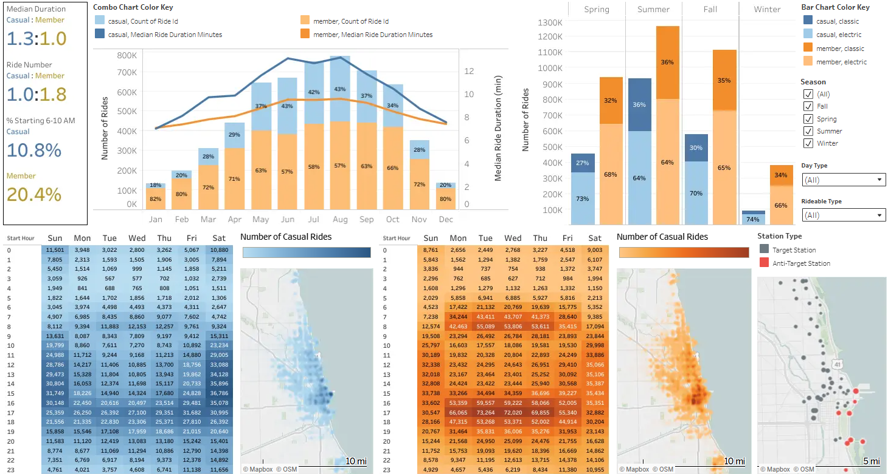
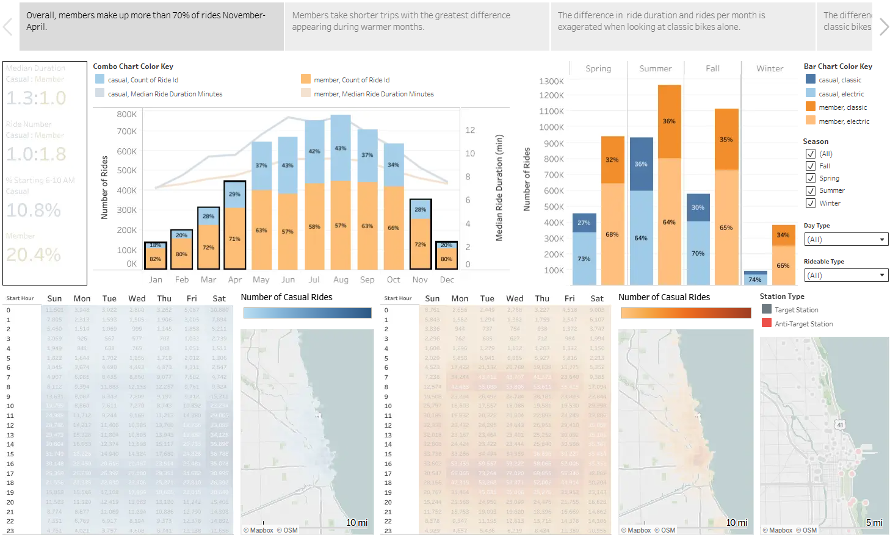
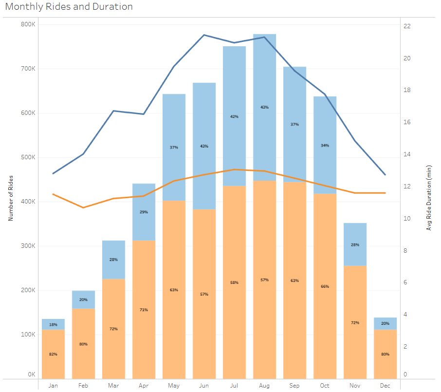
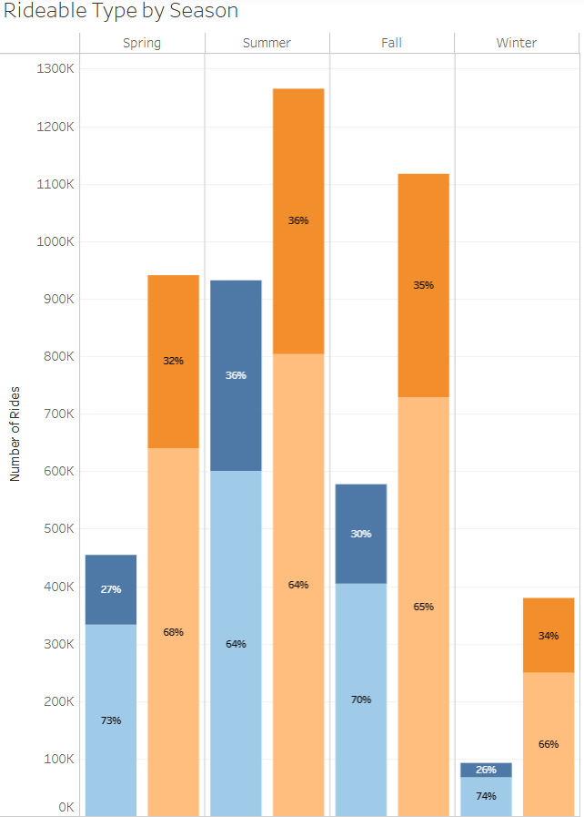
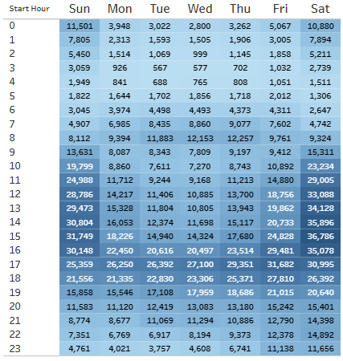
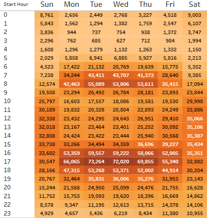
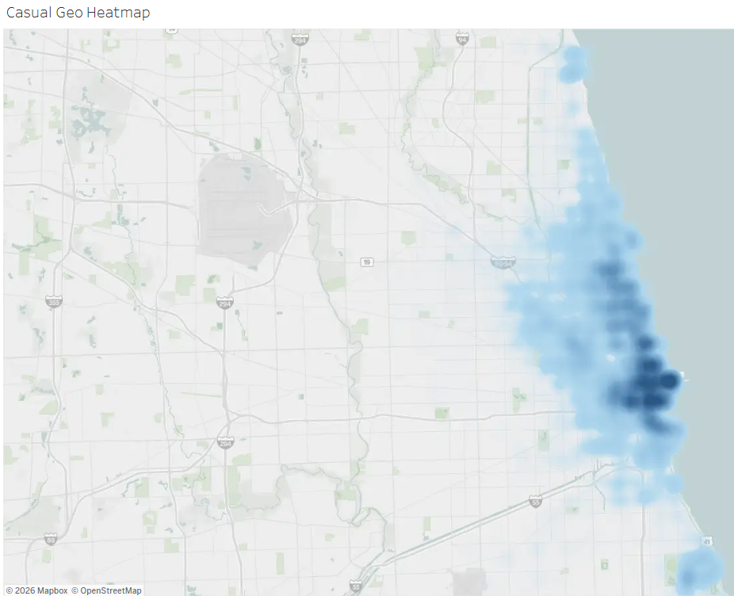
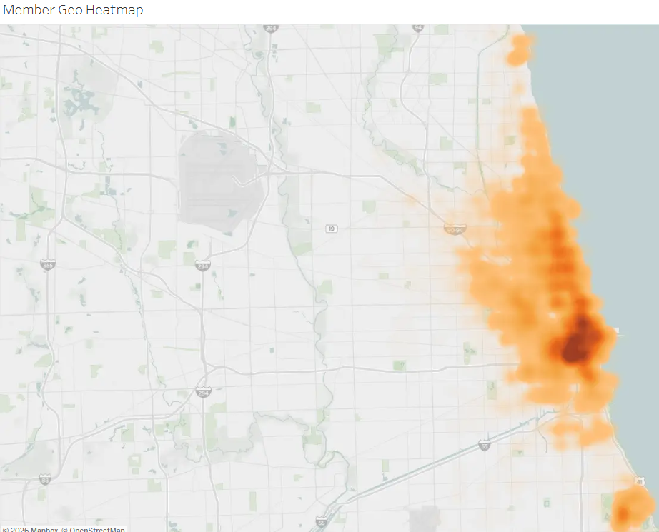
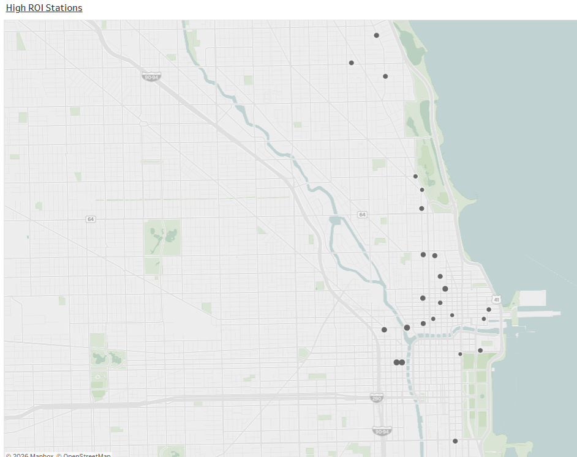
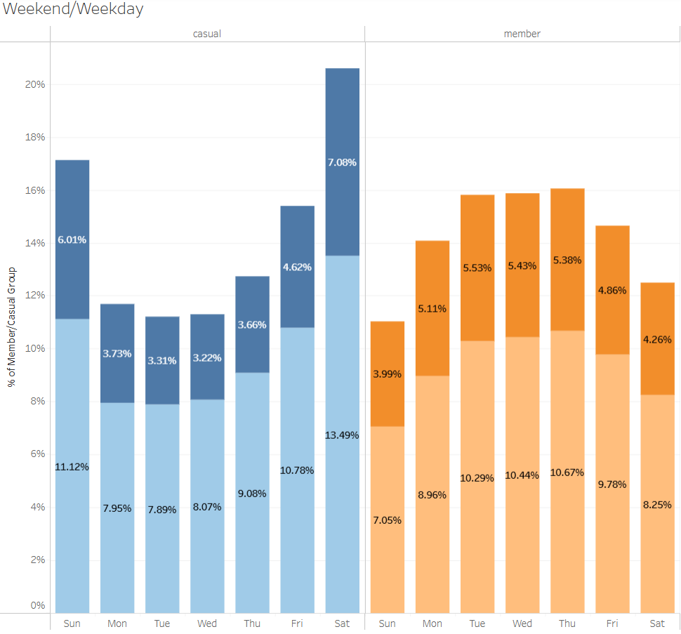

# Ride Share Membership Growth Marketing Analysis

Author: William Rivers

---

## Description
This case study is part of my capstone project for the Google Data Analytics Professional Certificate. My role was 
to work as a data analyst for a fictional company, Cyclistic, and use the six steps of the data analysis process 
(Ask, Prepare, Process, Analyze, Share, and Act) to present my findings on the past year of ride data.

### Scenario
I am a data analyst on the marketing analyst team at Cyclistic, a bike-share company in Chicago. The director of 
marketing believes the company’s future success depends on maximizing the number of annual memberships. Therefore, 
my team wants to understand how casual riders and annual members use Cyclistic bikes differently. From these 
insights, my team will design a new marketing strategy to convert casual riders into annual members.

---

## Step 1: Ask
### 1.1 Business Task

Accelerate revenue and annual membership growth by analyzing aggregate trip metrics to discover distinct usage 
patterns for casual riders and annual members, equipping marketing teams with data-supported profiles needed to 
optimize conversion campaigns.

### 1.2 Key Objectives

1) **Develop Behavioral Profiles**: Segment ride data to isolate casual use that mirrors member behavior.
2) **Optimize Campaign Timing**: Pinpoint high-yield seasonal windows for aggressive marketing by mapping fluctuations in ride volume.
3) **Locate Geographic Hotspots**: Identify high-density stations for high-ROI out-of-home (OOH) advertisements.
4) **Define Conversion Triggers**: Translate clear cost-benefit metrics to establish where annual membership becomes more economical.

### 1.3 Deliverables

1. A clear statement of the business task
2. A description of all data sources used
3. Documentation of any cleaning or manipulation of data
4. A summary of my analysis
5. Supporting visualizations and key findings
6. My top recommendations based on my analysis

### 1.4 Key Stakeholders

* **Director of Marketing**: My manager. Believes that maximizing annual membership is key to the company's success.

* **Marketing analytics team**: A team of data analysts, including me, who are responsible for collecting, analyzing,
  and reporting data that helps guide marketing strategy.

* **Executive team**: The detail-oriented executive team will decide whether to approve the recommended marketing program.

---

## Step 2: Prepare
### 2.1 Data Source Description
The [raw data](https://divvy-tripdata.s3.amazonaws.com/index.html), stripped of personal identifying information, is publicly 
available where Divvy, the real-world counterpart to the fictional company Cyclistic, publishes their records from June 1, 
2020 to present. It is available through Motivate International Inc. under this [license](https://divvybikes.com/data-license-agreement).

The ride data in each file is organized into 13 columns. These columns are ride_id (String), rideable_type (String), 
started_at (TimeStamp), ended_at (TimeStamp), start_station_name (String), start_station_id (String), end_station_name 
(String), end_station_id (String), start_lat (Float), start_lng (Float), end_lat (Float), end_lng (Float), member_casual 
(String). All together, the files represent over 6 million rows with each row representing a single ride. Each file is 
saved in the format YYYY_MM_ride_share_data.

### 2.2 Is Data ROCCC?

1. **Reliable**: The data is generally reliable, but there are many rows with missing fields that I will address in data cleaning.

2. **Original**: The data is original as it was collected and maintained by the source company (first-party source).

3. **Comprehensive**: The data is comprehensive because all fields necessary to identify characteristics of members and casual riders are included.

4. **Current**: The data is current and covers the last year of ride data.

5. **Cited**: The data is citable and was obtained from the company that collected it (first-party source). See source linked above.

Overall, this dataset is considered to be of good quality and can be used to make business recommendations.

---

## Step 3: Process
### 3.1 Upload and Combine csv Files
I specifically wanted my first project to use SQL since it is one of the core skills in any data field. Six of the files 
(06/2025, 07/2025, 08/2025, 09/2025, 10/2025, and 05/2026) were over 100 MB and too large to upload to BigQuery directly. 
The following python script was used to split these files into two smaller parts.

```python
# import package and alias
import pandas as pd

# convert the csv files into data frames
df_2025_06 = pd.read_csv(r'data/raw_data/2025_06_ride_share_data.csv')
df_2025_07 = pd.read_csv(r'data/raw_data/2025_07_ride_share_data.csv')
df_2025_08 = pd.read_csv(r'data/raw_data/2025_08_ride_share_data.csv')
df_2025_09 = pd.read_csv(r'data/raw_data/2025_09_ride_share_data.csv')
df_2025_10 = pd.read_csv(r'data/raw_data/2025_10_ride_share_data.csv')
df_2026_05 = pd.read_csv(r'data/raw_data/2026_05_ride_share_data.csv')

# chunk_size is the maximum number of rows per output file; 400000 rows is around 70-80 MB.
chunk_size = 400000 
count=1

# iterate through each data frame and turn each chunk into its own csv
for i in range(0, len(df_2025_06), chunk_size):
    chunk = df_2025_06.iloc[i:i + chunk_size]
    chunk.to_csv("2025_06_ride_share_data_pt_" + str(count) + ".csv", index=False)
    count += 1

count=1
for i in range(0, len(df_2025_07), chunk_size):
    chunk = df_2025_07.iloc[i:i + chunk_size]
    chunk.to_csv("2025_07_ride_share_data_pt_" + str(count) + ".csv", index=False)
    count += 1

count=1
for i in range(0, len(df_2025_08), chunk_size):
    chunk = df_2025_08.iloc[i:i + chunk_size]
    chunk.to_csv("2025_08_ride_share_data_pt_" + str(count) + ".csv", index=False)
    count += 1

count=1
for i in range(0, len(df_2025_09), chunk_size):
    chunk = df_2025_09.iloc[i:i + chunk_size]
    chunk.to_csv("2025_09_ride_share_data_pt_" + str(count) + ".csv", index=False)
    count += 1

count=1
for i in range(0, len(df_2025_10), chunk_size):
    chunk = df_2025_10.iloc[i:i + chunk_size]
    chunk.to_csv("2025_10_ride_share_data_pt_" + str(count) + ".csv", index=False)
    count += 1

count=1
for i in range(0, len(df_2026_05), chunk_size):
    chunk = df_2026_05.iloc[i:i + chunk_size]
    chunk.to_csv("2026_05_ride_share_data_pt_" + str(count) + ".csv", index=False)
    count += 1
```

I then uploaded these chunked files and the 6 unchunked files that were already appropriately sized to BigQuery. 
To prepare for data cleaning, I used the following query to create a table called raw_combined_ride_share that 
contains all rows from each file. I did this to avoid needing long, multi-joins for most of my queries.

```sql
--Combine the individual files into a single table
CREATE TABLE `ride-share-500415.Ride_Share_Marketing_Analysis.raw_combined_ride_share` AS (
    SELECT *
    FROM `ride-share-500415.Ride_Share_Marketing_Analysis.2025_06_ride_share_data_pt_1`
    UNION ALL
    SELECT *
    FROM `ride-share-500415.Ride_Share_Marketing_Analysis.2025_06_ride_share_data_pt_2`
    UNION ALL
    SELECT *
    FROM `ride-share-500415.Ride_Share_Marketing_Analysis.2025_07_ride_share_data_pt_1`
    UNION ALL
    SELECT *
    FROM `ride-share-500415.Ride_Share_Marketing_Analysis.2025_07_ride_share_data_pt_2`
    UNION ALL
    SELECT *
    FROM `ride-share-500415.Ride_Share_Marketing_Analysis.2025_08_ride_share_data_pt_1`
    UNION ALL
    SELECT *
    FROM `ride-share-500415.Ride_Share_Marketing_Analysis.2025_08_ride_share_data_pt_2`
    UNION ALL
    SELECT *
    FROM `ride-share-500415.Ride_Share_Marketing_Analysis.2025_09_ride_share_data_pt_1`
    UNION ALL
    SELECT *
    FROM `ride-share-500415.Ride_Share_Marketing_Analysis.2025_09_ride_share_data_pt_2`
    UNION ALL
    SELECT *
    FROM `ride-share-500415.Ride_Share_Marketing_Analysis.2025_10_ride_share_data_pt_1`
    UNION ALL
    SELECT *
    FROM `ride-share-500415.Ride_Share_Marketing_Analysis.2025_10_ride_share_data_pt_2`
    UNION ALL
    SELECT *
    FROM `ride-share-500415.Ride_Share_Marketing_Analysis.2025_11_ride_share_data`
    UNION ALL
    SELECT *
    FROM `ride-share-500415.Ride_Share_Marketing_Analysis.2025_12_ride_share_data`
    UNION ALL
    SELECT *
    FROM `ride-share-500415.Ride_Share_Marketing_Analysis.2026_01_ride_share_data`
    UNION ALL
    SELECT *
    FROM `ride-share-500415.Ride_Share_Marketing_Analysis.2026_02_ride_share_data`
    UNION ALL
    SELECT *
    FROM `ride-share-500415.Ride_Share_Marketing_Analysis.2026_03_ride_share_data`
    UNION ALL
    SELECT *
    FROM `ride-share-500415.Ride_Share_Marketing_Analysis.2026_04_ride_share_data`
    UNION ALL
    SELECT *
    FROM `ride-share-500415.Ride_Share_Marketing_Analysis.2026_05_ride_share_data_pt_1`
    UNION ALL
    SELECT *
    FROM `ride-share-500415.Ride_Share_Marketing_Analysis.2026_05_ride_share_data_pt_2`
);
```

### 3.2 Identifying Nulls

I started by searching each column for null values and also empty strings in string columns.

```sql
-- Checking nulls in each column
SELECT COUNTIF(ride_id IS NULL OR ride_id = '') AS null_ride_id,
    COUNTIF(rideable_type IS NULL OR rideable_type = '') AS null_rideable_type,
    COUNTIF(started_at IS NULL) AS null_started_at,
    COUNTIF(ended_at IS NULL) AS null_ended_at,
    COUNTIF(start_station_name IS NULL OR start_station_name = '') AS null_start_station_name,
    COUNTIF(start_station_id IS NULL OR start_station_id = '') AS null_start_station_id,
    COUNTIF(end_station_name IS NULL OR end_station_name = '') AS null_end_station_name,
    COUNTIF(end_station_id IS NULL OR end_station_id = '') AS null_end_station_id,
    COUNTIF(start_lat IS NULL) AS null_start_lat,
    COUNTIF(start_lng IS NULL) AS null_start_lng,
    COUNTIF(end_lat IS NULL) AS null_end_lat,
    COUNTIF(end_lng IS NULL) AS null_end_lng,
    COUNTIF(member_casual IS NULL OR member_casual = '') AS null_member_casual
FROM `ride-share-500415.Ride_Share_Marketing_Analysis.raw_combined_ride_share`;
```

NOTE: COUNTIF() is specific to GoogleSQL and probably a few other dialects but is not standard SQL. Would need 
to use SUM(CASE WHEN) in standard sql

| column                  | null_count|
|-------------------------|-----------|
| null_ride_id            | 0         |
| null_rideable_type      | 0         |
| null_started_at         | 0         |
| null_ended_at           | 0         |
| null_start_station_name | 1249667   |
| null_start_station_id   | 1249667   |
| nulle_end_station_name  | 1314334   |
| null_end_station_id     | 1314334   |
| null_start_lat          | 0         |
| null_start_lng          | 0         |
| null_end_lat            | 5896      |
| null_end_lng            | 5896      |
| null_member_casual      | 0         |


While many columns do not contain any null values, there are still over 1 million rows containing nulls. 
I plan to use the latitude and longitude data to assign the correct station name and id to fill in some 
of the missing data. I also planned to use the station name and id to assign latitude and longitude based 
on the average for the station id. First, I needed to identify any duplicate rides and remove them out so 
they do not affect the results.

### 3.3 Removing Duplicate Rides

I started by searching for duplicated ride ids with GROUP BY.

```sql
--Determine number of duplicate records
SELECT ride_id, COUNT(ride_id)
FROM `ride-share-500415.Ride_Share_Marketing_Analysis.raw_combined_ride_share`
GROUP BY ride_id
HAVING COUNT(ride_id) > 1
ORDER BY COUNT(ride_id) DESC;
```

35 ride ids appeared twice. I suspected they were duplicated rides and planned to remove them from the 
table, but visualized them first to make sure.

```sql
--Examine the 35 duplicates to ensure they can be removed
SELECT *
FROM `ride-share-500415.Ride_Share_Marketing_Analysis.raw_combined_ride_share`
WHERE ride_id IN (
  SELECT ride_id
  FROM `ride-share-500415.Ride_Share_Marketing_Analysis.raw_combined_ride_share`
  GROUP BY ride_id
  HAVING COUNT(ride_id) > 1
)
ORDER BY ride_id;
```

After verifying that these represent duplicated rides, I created a back up table and removed the duplicates 
using the following queries.

```sql
--Create a backup table as a safety measure
CREATE OR REPLACE TABLE `ride-share-500415.Ride_Share_Marketing_Analysis.raw_combined_ride_share_backup` AS (
  SELECT *
  FROM `ride-share-500415.Ride_Share_Marketing_Analysis.raw_combined_ride_share`
);
```

NOTE: CREATE OR REPLACE TABLE is more common in Big Data architecture. In other environments, I would need to 
use a different name.

```sql
--Remove duplicate rides
CREATE OR REPLACE TABLE `ride-share-500415.Ride_Share_Marketing_Analysis.raw_combined_ride_share` AS (
    SELECT * EXCEPT(row_num)
    FROM (
      SELECT *,
      ROW_NUMBER() OVER (
        PARTITION BY ride_id
      ) as row_num
      FROM `ride-share-500415.Ride_Share_Marketing_Analysis.raw_combined_ride_share`
    )
    WHERE row_num = 1
);
```

I chose to use CREATE OR REPLACE TABLE over UPDATE for two main reasons. First, on large tables in BigQuery, 
CREATE OR REPLACE is more efficient than UPDATE. Second, in order to use DML in Big Query you have to link a 
payment option and I would rather avoid that if possible.

### 3.4 Checking Station Names and Ids

I also checked start_station_name, start_station_id, end_station_name, and end_station_id to make sure that there 
were no misspellings in the station names and that a station name always corresponded to the same station id. I 
downloaded the results of the following two queries and uploaded them to Google Sheets to use the filtering in place function 
to more easily identify where two station names corresponded to the same station id.

```sql
--Checking for spelling variations, that the same id always matched the same name, and vice versa
SELECT start_station_name, start_station_id, COUNT(*)
FROM `ride-share-500415.Ride_Share_Marketing_Analysis.raw_combined_ride_share`
GROUP BY start_station_name, start_station_id
ORDER BY start_station_name, start_station_id;
```

```sql
--Swapped the order for easy cross-referencing with the results of the previous query
SELECT DISTINCT start_station_id, start_station_name
FROM `ride-share-500415.Ride_Share_Marketing_Analysis.raw_combined_ride_share`
ORDER BY start_station_id, start_station_name
```

Both queries were repeated for end_station_name and end_station_id. There was significant, unexplained variation to 
station names in both the start_station_names and end_station_names fields. I came accross 5 classifications of 
anomalies in these columns.

1) Same station id, slight variation to the station name abbreviation (i.e. Street vs St)
2) Same station id, symbol or number added to the end of the station name (i.e. 1, *, etc.)
3) Same station id, same station name but one is marked archived
4) Same station id, different station name (street intersection always located within 1-2 blocks as determined by Google Maps)
5) Different station id, same station name

In each case, the count for each combination was too high to be easily explained as data entry errors. I decided to 
leave the fields as they were since there was too much variation for it to be an accident. I suspect that the 
changes represent changes to station locations, upgrades to stations, and spliting stations into 2 nearby stations 
which should all be tracked in an internal company document that I do not have access to. With access to that 
information, I would use it as a reference to determine whether there are any true errors and whether any of these 
station names/ids need to be combined.

### 3.5 Cleaning Station Id, Station Name, Latitude, and Longitude

First, I created another backup for my table. Next, I identified the average latitute and longitude for each start 
station id and name combination and did some research to find out that the average city block in Chicago is 100 
meters by 200 meters. I ran the following query and an identical query for the end stations to help me understand 
how many of the rides with null station ids and names fall close to a known station. My assumption was that the 
stations would not be larger than 30 meters but I wanted to see the numbers so I could make an informed decision.

```sql
--Decide on the appropriate distance from the station average that should still belong to the station
WITH station_avgs AS (
  SELECT 
    start_station_id,
    start_station_name,
    ST_GEOGPOINT(AVG(start_lng), AVG(start_lat)) AS station_point
  FROM `ride-share-500415.Ride_Share_Marketing_Analysis.raw_combined_ride_share`
  WHERE start_station_id IS NOT NULL 
    AND start_lat IS NOT NULL 
    AND start_lng IS NOT NULL
  GROUP BY start_station_id, start_station_name
), --Calculate the average from each station where there are no null coordinates

distinct_missing_locs AS (
  SELECT 
    ROW_NUMBER() OVER() AS location_id, --Needed for partitioning in the next CTE
    start_lat,
    start_lng
  FROM `ride-share-500415.Ride_Share_Marketing_Analysis.raw_combined_ride_share`
  WHERE start_station_id IS NULL 
    AND start_lat IS NOT NULL 
    AND start_lng IS NOT NULL
  GROUP BY start_lat, start_lng
), --Group rides with null stations by coordinate so the query executes faster and more efficiently

nearest_station AS (
  SELECT 
    locs.start_lat,
    locs.start_lng,
    ST_DISTANCE(ST_GEOGPOINT(locs.start_lng, locs.start_lat), station_point) AS distance
  FROM distinct_missing_locs locs
  CROSS JOIN station_avgs s --CROSS JOIN to compare each unique coordinate to every station's average point
  QUALIFY ROW_NUMBER() OVER (
    PARTITION BY locs.location_id --Cannot partition by a float (start_lat or start_lng)
    ORDER BY ST_DISTANCE(ST_GEOGPOINT(locs.start_lng, locs.start_lat), s.station_point) ASC
  ) = 1 --QUALIFY kept only the station whose average is nearest to each coordinate (rank 1)
)

SELECT 
  CASE 
    WHEN n.distance IS NULL THEN 'Missing Lat/Lng'
    WHEN n.distance < 30 THEN 'Within 30m'
    WHEN n.distance >= 30 AND n.distance < 40 THEN '30m to 40m away'
    WHEN n.distance >= 40 AND n.distance < 50 THEN '40m to 50m away'
    WHEN n.distance >=50 AND n.distance < 60 THEN '50m to 60m away'
    WHEN n.distance >=60 AND n.distance < 70 THEN '60m to 70m away'
    WHEN n.distance >=70 AND n.distance <80 THEN '70m to 80m away'
    WHEN n.distance >=80 AND n.distance <90 THEN '80m to 90m away'
    WHEN n.distance >=90 AND n.distance <100 THEN '90m to 100m away'
    ELSE 'Over 100m away'
  END AS distance_category, --Check each distance band for how many rides fall into each
  COUNT(*) AS total_trips
FROM `ride-share-500415.Ride_Share_Marketing_Analysis.raw_combined_ride_share` t
LEFT JOIN nearest_station n
  ON t.start_lat = n.start_lat
  AND t.start_lng = n.start_lng
WHERE t.start_station_id IS NULL
GROUP BY 1
ORDER BY 1;
```

NOTE: Had difficulty with isolating the nearest station. After researching online, I discovered two methods. 
The QUALIFY statement included here and using CTEs with a WHERE rank condition in the main query. I chose to use 
QUALIFY here because I thought it would be more efficient since it is a function specific to GoogleSQL. After 
further research, it appears to use nearly identical methods. 

**Start Station Results**
| distance_category | total_trips  |
|-------------------|--------------|
| 30m to 40m away   | 6007         |
| 40m to 50m away   | 9368         |
| 50m to 60m away   | 9454         |
| 60m to 70m away   | 50765        |
| 70m to 80m away   | 20242        |
| 80m to 90m away   | 117217       |
| 90m to 100m away  | 42711        |
| Over 100m away    | 980419       |
| Within 30m        | 13478        |

**End Station Results**
| distance_category | total_trips  |
|-------------------|--------------|
| 30m to 40m away   | 6174         |
| 40m to 50m away   | 10013        |
| 50m to 60m away   | 10201        |
| 60m to 70m away   | 45345        |
| 70m to 80m away   | 20754        |
| 80m to 90m away   | 67645        |
| 90m to 100m away  | 94507        |
| Missing Lat/Lng   | 5890         |
| Over 100m away    | 1039124      |
| Within 30m        | 14667        |

I was particularly surprised to find that there were so many trips starting or ending over 100 meters away 
from any identified station since this number represents around one sixth of the total rides in the past 
year. If there are any clusters, they may make excellent locations for new stations. I decided that 50 
meters is an reasonable radius to set so that I don't accidentally pull rides from opposite of the short 
side of blocks. I then created a backup table and assigned a station id and name to rides where the fields 
were NULL and within 50 meters of a station average. 

```sql
--Fill null station ids within 50 meters of a station with that station's average coordinate
CREATE OR REPLACE TABLE `ride-share-500415.Ride_Share_Marketing_Analysis.raw_combined_ride_share` AS (
    WITH station_avgs AS (
      SELECT
        start_station_id,
        start_station_name,
        ST_GEOGPOINT(AVG(start_lng), AVG(start_lat)) AS station_point
      FROM `ride-share-500415.Ride_Share_Marketing_Analysis.raw_combined_ride_share`
      WHERE start_station_id IS NOT NULL
        AND start_lat IS NOT NULL
        AND start_lng IS NOT NULL
      GROUP BY start_station_id, start_station_name
    ), --Calculate the average from each station where there are no null coordinates
    
    distinct_missing_locs AS (
      SELECT
        ROW_NUMBER() OVER() AS location_id, --Needed for partitioning in the next CTE
        start_lat,
        start_lng
      FROM `ride-share-500415.Ride_Share_Marketing_Analysis.raw_combined_ride_share`
      WHERE start_station_id IS NULL
        AND start_lat IS NOT NULL
        AND start_lng IS NOT NULL
      GROUP BY start_lat, start_lng
    ), --Group rides with null stations by coordinate so the query executes faster and more efficiently
    
    nearest_station AS (
      SELECT
        locs.start_lat,
        locs.start_lng,
        s.start_station_id AS matched_station_id,
        s.start_station_name AS matched_station_name,
        ST_DISTANCE(ST_GEOGPOINT(locs.start_lng, locs.start_lat), s.station_point) AS distance
      FROM distinct_missing_locs locs
      CROSS JOIN station_avgs s --CROSS JOIN compares each coordinate to all station average points
      QUALIFY ROW_NUMBER() OVER (
        PARTITION BY locs.location_id
        ORDER BY ST_DISTANCE(ST_GEOGPOINT(locs.start_lng, locs.start_lat), s.station_point) ASC
      ) = 1 --QUALIFY kept only the station whose average is nearest to each coordinate (rank 1)
    )
    
    SELECT
      t.* EXCEPT(start_station_id, start_station_name),
      COALESCE(
        t.start_station_id, --Keep station ids already filled
        IF(n.distance <= 50, n.matched_station_id, NULL)
      ) AS start_station_id, --Leave null if the distance is more than 50 meters
      COALESCE(
        t.start_station_name, --Keep station names already filled
        IF(n.distance <= 50, n.matched_station_name, NULL)
      ) AS start_station_name --Leave null if the distance is more than 50 meters
    FROM `ride-share-500415.Ride_Share_Marketing_Analysis.raw_combined_ride_share` t
    LEFT JOIN nearest_station n
       ON t.start_lat = n.start_lat
       AND t.start_lng = n.start_lng
);
```

### 3.6 Cleaning Ride Time and Speed

First, I visualized the rides where the duration of the trip was either negative, indicating an error in 
the started_at and ended_at data, or over 1440 since it is not reasonable to assume that clients rented 
the bikes for more than one day at a time.

```sql
--Checking duration buckets to understand the breakdown
WITH time_data AS (
    SELECT ROUND(TIMESTAMP_DIFF(ended_at, started_at, minute),0) AS ride_duration
    FROM `ride-share-500415.Ride_Share_Marketing_Analysis.raw_combined_ride_share`
    WHERE started_at IS NOT NULL AND ended_at IS NOT NULL
    ) --Calculates ride duration
    
SELECT
    CASE WHEN ride_duration < 0 THEN 'Negative duration'
        WHEN ride_duration >= 0 AND ride_duration < 2 THEN 'Possible false start'
        WHEN ride_duration >= 2 AND ride_duration < 60 THEN 'Within 1 hour'
        WHEN ride_duration >= 60 AND ride_duration < 180 THEN '1-3 hours'
        WHEN ride_duration >= 180 AND ride_duration < 360 THEN '3-6 hours'
        WHEN ride_duration >= 360 AND ride_duration < 720 THEN '6-12 hours'
        WHEN ride_duration >= 720 AND ride_duration < 1440 THEN '12-24 hours'
        WHEN ride_duration >= 1440 THEN "Over 24 hours"
    END AS time_category, --Creates buckets for comparison
    COUNT(*) AS total_trips
FROM time_data
GROUP BY 1
ORDER BY 2;
```

| time_category        | total_trips  |
|----------------------|--------------|
| Negative duration    | 29           |
| 6-12 hours           | 1961         |
| 12-24 hours          | 2464         |
| Over 24 hours        | 5836         |
| 3-6 hours            | 6755         |
| 1-3 hours            | 107912       |
| Possible false start | 123771       |
| Zero duration        | 161323       |
| Within 1 hour        | 5438617      |

The negative durations must be equipment malfunction and the zero durations might be bike docking errors 
that rounded down. Regardless, this deserves additional investigation in the future as there appears to be 
a breakdown in the data collection process. I am surprised by the several thousand rides over 12 hours long 
and suspect that most of them are rides where the bikes were left at locations that were not a station and 
that the duration may not represent the actual time that the client left the bike. 

```sql
--Compare null station id count to rides over 12 hours count
WITH time_data AS (
    SELECT
        start_station_id,
        end_station_id,
        ROUND(TIMESTAMP_DIFF(ended_at, started_at, minute),0) AS ride_duration
    FROM `ride-share-500415.Ride_Share_Marketing_Analysis.raw_combined_ride_share`
    WHERE started_at IS NOT NULL AND ended_at IS NOT NULL
    ) --Calculate ride duration
    
SELECT
    COUNTIF(start_station_id IS NULL) AS start_nulls,
    COUNTIF(end_station_id IS NULL) AS end_nulls,
    COUNT(*) AS rides_over_12_hours
FROM time_data
WHERE ride_duration > 720;
```

| start_nulls | end_nulls | rides_over_12_hours  |
|-------------|-----------|----------------------|
| 0           | 5775      | 8299                 |

I realized that some of these rides might have been captured by my earlier attempts to assign station_names 
so I repeated the query using the backup table. Three rides originally had a null end station and had been 
reassigned to a station on the same block. These three rides may represent clients "abandoning" the bikes 
near a station that is full or that they otherwise are not able to access. I also reran the original query, 
minus the start station id nulls since there were none, looking at only the rides that lasted more than 24 
hours.

| end_nulls | rides_over_24  |
|-----------|----------------|
| 5707      | 5836           |

The 119 rides that were over 24 hours long but have an end station, may be due to the bikes being returned 
to a station but the rides not officially ending either due to user error or equipment malfunction. The 
remainder almost certainly represent stolen bikes or those abandoned at least 50 meters away from any 
station. When analyzing ride duration, I plan to exclude rides over 24 hours when analyzing the ride 
duration so they don't skew the results but I want them included when I look for natural groupings in the 
latitude/longitude data for rides without a station id. The vast majority of the ride durations over 1440 
minutes have a null end station name and end at 1499.0 minutes. I suspect that the timer automatically 
stops at 1499 minutes and the ride automatically ends if the bike has not already been returned.

The large number of rides that lasted betweeon 0 and 2 minutes was surprising. I included that category 
because I have seen people try out a similar company's product and decide that they did not like it without 
traveling anywhere. I expected several rides to fall under that category but over 120,000 was significantly 
higher than expected.

```sql
 --Check whether the stations changed on extremely short rides
WITH time_data AS (
    SELECT
        start_station_id,
        end_station_id,
        ROUND(TIMESTAMP_DIFF(ended_at, started_at, minute),0) AS ride_duration
    FROM `ride-share-500415.Ride_Share_Marketing_Analysis.raw_combined_ride_share`
    WHERE started_at IS NOT NULL AND ended_at IS NOT NULL
) --Calculate ride duration
    
SELECT
  COUNT(*) AS ct
FROM time_data
WHERE ride_duration > 0 AND ride_duration < 2
  AND start_station_id != end_station_id;
```

NOTE: I have since learned that if either start or end station is null above filter evaluates as false and 
excludes them even though the records don't match. This means my data cleaning was not as thorough as intended 
and is something to note for the future. COALESCE(start_station_id, 'A') != COALESCE(end_station_id, 'B') 
solves this my subsituting a string for any nulls.

57,067 rides had a different start and end station despite the trip length being between 0 and 2 minutes.

```sql
--When station did not change, was there any difference between members and casuals?
WITH time_data AS (
    SELECT
        start_station_id,
        end_station_id,
        member_casual,
        ROUND(TIMESTAMP_DIFF(ended_at, started_at, minute),0) AS ride_duration
    FROM `ride-share-500415.Ride_Share_Marketing_Analysis.raw_combined_ride_share`
    WHERE started_at IS NOT NULL AND ended_at IS NOT NULL
    ) --Calculate ride duration
    
SELECT
  member_casual,
  COUNT(*) AS ct
FROM time_data
WHERE ride_duration > 0 AND ride_duration < 2
  AND start_station_id = end_station_id
GROUP BY member_casual;
```

The number of rides with extremely short duration where the start and end stations were the same were very similar 
between members and casual users. I initially suspected that most of this category was made up of people that 
either couldn't figure out how the system worked and gave up or ended up not using the product for a similar 
reason. The fact that members and casuals are similarly represented makes that less likely as members likely 
understand how the system works before purchasing the membership. To exclude rides that seem to have not 
really taken place, I decided to keep rides where the station changed or the distance was more than 50 meters and 
discard the rest as they appear to be noise generated by poor docking or accidental undocking. I also decided to 
remove any rides with a negative or zero durations as that indicates likely equipment malfunction.

Lastly, I examined the speed with which the ride seemingly traveled. I researched bike speed and found that 
professional cyclists on flat ground tend to average around 25-30 mph with specialized light-weight bikes and 
that casual cyclists average around 13 mph. Additionally, I learned that the e-bike features a pedal assist that 
allows riders to more easily maintain a high speed but that it cuts off at 20 mph. Additionally, traffic, 
pedestrians, red lights, hills, wind, etc. all lower the maximum safe speed of the bike. Finally, I am using 
straight line distance between the start and end points because I do not have access to route data. The true 
speed would be even higher given that the true distance is higher than the straight line distance. I decided 
to establish a cutoff of 11 m/s (24.6 mph) for e-bikes and 8.5 m/s (19.0 mph) for standard bikes. I still find 
it unlikely that cyclists manage to maintain those speeds as an average, but don't want to remove rides in more 
open areas like parks where riders might be able to maintain high speeds.

```sql
--Identify any issues related to how quickly bikes traveled during the ride
WITH time_data AS (
    SELECT
        rideable_type,
        ROUND(TIMESTAMP_DIFF(ended_at, started_at, second),1) AS ride_duration,
        ST_DISTANCE(ST_GEOGPOINT(start_lng, start_lat), ST_GEOGPOINT(end_lng, end_lat)) AS ride_distance
    FROM `ride-share-500415.Ride_Share_Marketing_Analysis.raw_combined_ride_share`
    WHERE started_at IS NOT NULL AND ended_at IS NOT NULL AND end_lng IS NOT NULL AND end_lat IS NOT NULL
    ) --Calculate ride duration and distance
    
SELECT --Count rides with speeds that are unrealistically fast
  COUNT(*) AS ct
FROM time_data
WHERE
  CASE
    WHEN ride_duration > 0 AND ride_distance/ride_duration > 8.5 AND rideable_type = 'classic_bike' THEN 1
    WHEN ride_duration > 0 AND ride_distance/ride_duration > 11 AND rideable_type = 'electric_bike' THEN 1
    ELSE 0 --electric bikes have pedal assist which makes high speeds easier to maintain
  END = 1;
```

I identified 26,069 rides that needed to be excluded from the cleaned data for being unreasonably fast. The most 
likely cause for this is GPS drift on very short trips, equipment malfunction, or the bikes being transported to 
another station (or repair facility) by motor vehicle. This deserves additional investigation in the future as 
there appears to be a breakdown in the data collection process.

I created a new table called cleaned_combined_ride_share with 4 new columns called ride_duration_minutes, 
day_of_week, month, and distance_meters. I filtered out rides with a duration 0 minutes or less, rides with a 
duration less than 2 minutes that did not travel at least 50 meters or end at a different station, and rides 
where their straight line speed was over 8.5 m/s for classic bikes or over 11 m/s for electric bikes.

```sql
CREATE OR REPLACE TABLE `ride-share-500415.Ride_Share_Marketing_Analysis.cleaned_combined_ride_share` AS (
    WITH trips AS (
        SELECT
          ride_id,
          rideable_type,
          started_at,
          ended_at,
          ROUND(TIMESTAMP_DIFF(ended_at, started_at, SECOND) / 60.0, 2) AS ride_duration_minutes,
          EXTRACT(MONTH FROM started_at) AS month,
          EXTRACT(DAYOFWEEK FROM started_at) AS day_of_week,
          start_station_name,
          start_station_id,
          end_station_name,
          end_station_id,
          start_lat,
          start_lng,
          end_lat,
          end_lng,
          ST_DISTANCE(
            ST_GEOGPOINT(start_lng, start_lat),
            ST_GEOGPOINT(end_lng, end_lat)
          ) AS distance_meters,
          ST_DISTANCE(
            ST_GEOGPOINT(start_lng, start_lat),
            ST_GEOGPOINT(end_lng, end_lat)
          ) / NULLIF(TIMESTAMP_DIFF(ended_at, started_at, SECOND),0) AS avg_velocity_m_per_s,
          member_casual
        FROM `ride-share-500415.Ride_Share_Marketing_Analysis.raw_combined_ride_share`
        WHERE end_lat IS NOT NULL AND end_lng IS NOT NULL
    ) --Created ride duration, month, day of week, distance, and average velocity columns
        
    SELECT *
    FROM trips
    WHERE ride_duration_minutes > 0 --No zero or negative durations
      AND CASE
          WHEN ride_duration_minutes <= 2
            AND distance_meters > 50 THEN 1
          WHEN ride_duration_minutes <= 2
            AND COALESCE(start_station_id, 'A') != COALESCE(end_station_id, 'B') THEN 1
          WHEN ride_duration_minutes > 2 THEN 1
          ELSE 0
        END = 1 --If durations <= 2 min, needs to travel 50 meters or change station
      AND CASE
          WHEN rideable_type = 'classic_bike'
            AND avg_velocity_m_per_s < 8.5 THEN 1
          WHEN rideable_type = 'electric_bike'
            AND avg_velocity_m_per_s < 11 THEN 1
          ELSE 0
        END = 1 --Speeds should be reasonable for an average velocity
);
```

---

## Step 4: Analyze

### 4.1 Overall Statistics

```sql
--Summary statistics for ride distance by user type
SELECT
  member_casual,
  ROUND(AVG(distance_meters), 2) AS avg_dist,
  ROUND(STDDEV(distance_meters), 2) AS std_dev_dist,
  ROUND(APPROX_QUANTILES(distance_meters, 4)[OFFSET(0)], 2) AS min_dist,
  ROUND(APPROX_QUANTILES(distance_meters, 4)[OFFSET(1)], 2) AS q1_dist,
  ROUND(APPROX_QUANTILES(distance_meters, 4)[OFFSET(2)], 2) AS q2_dist,
  ROUND(APPROX_QUANTILES(distance_meters, 4)[OFFSET(3)], 2) AS q3_dist,
  ROUND(APPROX_QUANTILES(distance_meters, 4)[OFFSET(4)], 2) AS max_dist
FROM `ride-share-500415.Ride_Share_Marketing_Analysis.cleaned_combined_ride_share`
GROUP BY member_casual;
```

**Distance Summary Statistics**
| type  | avg_dist| std_dev_dist |
|-------|---------|--------------|
|casual | 2185.47 | 2019.73      |
|member | 2257.79 | 1986.41      |

| type | min_dist | q1_dist | q2_dist | q3_dist | max_dist |
|----- |----------|---------|---------|---------|----------|
|casual| 0.0      | 932.55  | 1650.06 | 2855.99 | 48370.88 |
|member| 0.0      | 954.65  | 1636.13 | 2949.42 | 48370.88 |

There appears to be minimal difference between the straight line distance that members and casuals travel.
I assumed that casuals would be more likely to take roundtrips which would make their data favor the lower
quartile more heavily. That appears not to be the case. If the bikes had some form of odometer, this data 
would be much more helpful and informative. Using straight line distance between the start and stop 
coordinate provides very little context for the trip.

```sql
--Find percent of the total rides that were roundtrips split by user type
SELECT
  member_casual,
  ROUND(COUNT(CASE WHEN distance_meters = 0 THEN member_casual END)
    / NULLIF(COUNT(member_casual), 0) * 100, 2) AS pct_rnd_trip,
FROM `ride-share-500415.Ride_Share_Marketing_Analysis.cleaned_combined_ride_share`
GROUP BY member_casual;
```

| member_casual | pct_rnd_trip |
|---------------|--------------|
| casual        | 9.04         |
| member        | 3.33         |

After seeing that there wasn't an obvious distance difference, I wanted to know if I was right about causals 
making roundtrips more often. The results show that casuals are more likely to take round trips than members. 
However, the percentage of round trips was low for both so it is unlikely to help identify casuals behaving
similarly to members.

```sql
--Summary statistics for ride duration by user type
SELECT
  member_casual,
  ROUND(AVG(ride_duration_minutes), 2) AS avg_time,
  ROUND(STDDEV(ride_duration_minutes), 2) AS std_dev_time,
  ROUND(APPROX_QUANTILES(ride_duration_minutes, 4)[OFFSET(0)], 2) AS min_time,
  ROUND(APPROX_QUANTILES(ride_duration_minutes, 4)[OFFSET(1)], 2) AS q1_time,
  ROUND(APPROX_QUANTILES(ride_duration_minutes, 4)[OFFSET(2)], 2) AS q2_time,
  ROUND(APPROX_QUANTILES(ride_duration_minutes, 4)[OFFSET(3)], 2) AS q3_time,
  ROUND(APPROX_QUANTILES(ride_duration_minutes, 4)[OFFSET(4)], 2) AS max_time
FROM `ride-share-500415.Ride_Share_Marketing_Analysis.cleaned_combined_ride_share`
WHERE ride_duration_minutes <= 1440 --Excluded since bikes cannot be rented > 24 hours
GROUP BY member_casual;
```

**Duration Summary Statistics**
| type | avg_time | std_dev_time |
|------|----------|--------------|
|casual| 19.17    | 38.01        |
|member| 12.19    | 21.6         |

| type | min_time | q1_time | q2_time | q3_time | max_time |
|------|----------|---------|---------|---------|----------|
|casual| 0.02     | 6.47    | 11.47   | 21.03   | 1439.97  |
|member| 0.02     | 5.12    | 8.68    | 14.7    | 1439.82  |

Member ride durations tend to be shorter. Noteably, more than half of all member rides end before 10 
minutes and more than 75% end before 15 minutes. Member  durations also have lower variation than 
casual durations. Not only is the member standard deviation a little over half that of casuals, the 
interquartile range (middle 50%) is about 5 minutes narrower as well.

```sql
--Summary statistics for ride velocity by user type
SELECT
  member_casual,
  ROUND(AVG(avg_velocity_m_per_s), 2) AS avg_velocity,
  ROUND(STDDEV(avg_velocity_m_per_s), 2) AS std_dev_velocity,
  ROUND(APPROX_QUANTILES(avg_velocity_m_per_s, 4)[OFFSET(0)], 2) AS min_velocity,
  ROUND(APPROX_QUANTILES(avg_velocity_m_per_s, 4)[OFFSET(1)], 2) AS q1_velocity,
  ROUND(APPROX_QUANTILES(avg_velocity_m_per_s, 4)[OFFSET(2)], 2) AS q2_velocity,
  ROUND(APPROX_QUANTILES(avg_velocity_m_per_s, 4)[OFFSET(3)], 2) AS q3_velocity,
  ROUND(APPROX_QUANTILES(avg_velocity_m_per_s, 4)[OFFSET(4)], 2) AS max_velocity
FROM `ride-share-500415.Ride_Share_Marketing_Analysis.cleaned_combined_ride_share`
WHERE ride_duration_minutes <= 1440 --Excluded since bikes cannot be rented > 24 hours
GROUP BY member_casual;
```

**Velocity Summary Statistics**
| Type | avg_velocity | std_dev_velocity |
|------|--------------|------------------|
|casual| 2.72         | 1.66             |
|member| 3.45         | 1.46             |

| Type | min_velocity | q1_velocity | q2_velocity | q3_velocity | max_velocity |
|------|--------------|-------------|-------------|-------------|--------------|
|casual| 0.0          | 1.59        | 2.78        | 3.85        | 11.0         |
|member| 0.0          | 2.61        | 3.45        | 4.38        | 11.0         |

Member ride velocities are also higher as a result of relatively similar distances and much shorter durations. 
Again, if the bikes had an odometer that tracked the total distance covered, it would provide better context 
and enable better conclusions based on this data.

```sql
--Examine duration buckets for classic bikes based on how rides are priced
SELECT 
  CASE WHEN ride_duration_minutes >= 0 AND ride_duration_minutes <= 45 THEN '1) 0-45 min'
    WHEN ride_duration_minutes > 45 AND ride_duration_minutes <= 180 THEN '2) 45 min - 3 hrs'
    WHEN ride_duration_minutes >180 THEN '3) 3+ hrs'
    END AS duration_category, 
  ROUND(100 * COUNT(CASE WHEN member_casual = 'member' THEN member_casual END)
    / SUM(COUNT(CASE WHEN member_casual = 'member' THEN member_casual END)) OVER(), 2) AS pct_member, 
  ROUND(100 * COUNT(CASE WHEN member_casual = 'casual' THEN member_casual END)
    / SUM(COUNT(CASE WHEN member_casual = 'casual' THEN member_casual END)) OVER(), 2) AS pct_casual
FROM `ride-share-500415.Ride_Share_Marketing_Analysis.cleaned_combined_ride_share`
WHERE rideable_type = 'classic_bike'
GROUP BY 1
ORDER BY 1;
```

```sql
--Examine duration buckets for electric bikes based on how rides are priced
SELECT 
  CASE WHEN ride_duration_minutes >= 0 AND ride_duration_minutes <= 45 THEN '1) 0-45 min'
    WHEN ride_duration_minutes > 45 AND ride_duration_minutes <= 180 THEN '2) 45 min - 3 hrs'
    WHEN ride_duration_minutes >180 THEN '3) 3+ hrs'
    END AS duration_category, 
  ROUND(100 * COUNT(CASE WHEN member_casual = 'member' THEN member_casual END)
    / SUM(COUNT(CASE WHEN member_casual = 'member' THEN member_casual END)) OVER(), 2) AS pct_member, 
  ROUND(100 * COUNT(CASE WHEN member_casual = 'casual' THEN member_casual END)
    / SUM(COUNT(CASE WHEN member_casual = 'casual' THEN member_casual END)) OVER(), 2) AS pct_casual
FROM `ride-share-500415.Ride_Share_Marketing_Analysis.cleaned_combined_ride_share`
WHERE rideable_type = 'electric_bike'
GROUP BY 1
ORDER BY 1;
```

I had moderate trouble with the percent calculation because of the SUM window function. I forgot 
that I can do aggregate functions using window functions and almost used a CTE to calculate the sum 
for member and casual before realizing that I could just use OVER().

**Pricing Structure**
| Bike Type | Single Ride (Casual)  | Day Pass (Casual)      | Annual Membership                           |
|-----------|-----------------------|------------------------|-------------------------------------------- |
| Classic   | $1 unlock + $0.20/min | 3 hours, then 0.20/min | 45 min free, then $0.20/min                 |
| Electric  | $1 unlock + $0.44/min | 3 hours, then 0.44/min | Free unlock, 0.20/min ($6 cap until 45 min) |

**Classic Bike Results**
| duration_category | pct_member | pct_casual |
|-------------------|------------|------------|
| 1) 0-45 min       | 98.0       | 84.86      |
| 2) 45 min - 3 hrs | 1.8        | 14.17      |
| 3) 3+ hrs         | 0.2        | 0.97       |

**Electric Bike Results**
| duration_category | pct_member | pct_casual |
|-------------------|------------|------------|
| 1) 0-45 min       | 98.7       | 95.74      |
| 2) 45 min - 3 hrs | 1.22       | 4.22       |
| 3) 3+ hrs         | 0.08       | 0.04       |

With a free 45 minute grace period, it makes sense that members overwhelmingly end classic bike rides before 
45 minutes. I expected casuals to fall more heavily into the 45 min to 3 hour range with the day pass. In 
retrospect, it makes sense that day pass users would be more likely to take lots of short trips than 1 very 
long trip. It seems likely that most, if not all, of the trips in that category would be leisure rides and 
more heavily populated with tourists.

For electric bikes, the distribution of ride durations for members and casuals mirror each other more closely. 
This is likely due to the fact that electric bikes are over twice as expensive for casuals as for members. In 
other words, the members keep their usual economic, utilitarian usage while casuals adopt that same mindset 
due to the higher cost.

**Membership Annual Profit Point**
| Ride Duration | Single, classic | Single, electric | Day Pass, both  |
|:-------------:|:---------------:|:----------------:|:---------------:|
| 10 min        | 48 rides/year   | 27 rides/year    | 8 passes/year   |
| 15 min        | 36 rides/year   | 19 rides/year    | 8 passes/year   |

**Membership Monthly Profit Point**
| Ride Duration | Single, classic | Single, electric | Day Pass, both  |
|:-------------:|:---------------:|:----------------:|:---------------:|
| 10 min        | 4 rides/month   | 3 rides/month    | <1 pass/month   |
| 15 min        | 3 rides/month   | 2 rides/month    | <1 pass/month   |

These thresholds sound very easy to reach and presenting this information to casual riders after they reach 
each cutoff may entice them to try the membership.

### 4.2 Seasonality Analysis

```sql
--Identify when peak casual usage periods are in the year and when casual usage changes rapidly
WITH avgs AS (
SELECT
  month,
  COUNT(ride_id) AS ct,
  ROUND(AVG(
    CASE WHEN ride_duration_minutes <= 1440 THEN ride_duration_minutes END
    ), 2) AS avg_duration,
  ROUND(AVG(distance_meters), 2) AS avg_distance
FROM `ride-share-500415.Ride_Share_Marketing_Analysis.cleaned_combined_ride_share`
WHERE member_casual = 'casual'
GROUP BY month
) --Calculate average duration and distance per month

SELECT 
  month,
  ct,
  ROUND(
    (ct - LAG(ct) OVER(ORDER BY month)) / LAG(ct) OVER(ORDER BY month) * 100, 2
  ) AS pct_change_ct, --percent change in number of rides from previous month
  avg_duration,
  ROUND(
    (avg_duration - LAG(avg_duration) OVER(ORDER BY month)) / LAG(avg_duration) OVER(ORDER BY month) * 100, 2
  ) AS pct_change_dur, --percent change in ride duration from previous month
  avg_distance,
  ROUND(
    (avg_distance - LAG(avg_distance) OVER(ORDER BY month)) / LAG(avg_distance) OVER(ORDER BY month) * 100, 2
  ) AS pct_change_dist --percent change in ride distance from previous month
FROM avgs
ORDER BY month;
```

```sql
--Identify when peak member usage periods are in the year and when member usage changes rapidly
WITH avgs AS (
SELECT
  month,
  COUNT(ride_id) AS ct,
  ROUND(AVG(
    CASE WHEN ride_duration_minutes <= 1440 THEN ride_duration_minutes END
    ), 2) AS avg_duration,
  ROUND(AVG(distance_meters), 2) AS avg_distance
FROM `ride-share-500415.Ride_Share_Marketing_Analysis.cleaned_combined_ride_share`
WHERE member_casual = 'member'
GROUP BY month
) --Calculate average duration and distance per month

SELECT 
  month,
  ct,
  ROUND(
    (ct - LAG(ct) OVER(ORDER BY month)) / LAG(ct) OVER(ORDER BY month) * 100, 2
  ) AS pct_change_ct, --percent change in number of rides from previous month
  avg_duration,
  ROUND(
    (avg_duration - LAG(avg_duration) OVER(ORDER BY month)) / LAG(avg_duration) OVER(ORDER BY month) * 100, 2
  ) AS pct_change_dur, --percent change in ride duration from previous month
  avg_distance,
  ROUND(
    (avg_distance - LAG(avg_distance) OVER(ORDER BY month)) / LAG(avg_distance) OVER(ORDER BY month) * 100, 2
  ) AS pct_change_dist --percent change in ride distance from previous month
FROM avgs
ORDER BY month;
```

NOTE: In retrospect, I should have used COALESCE(lag expression, "N/A") to fill the blank spot in January.

**Casual Results**
| month | ct     | pct_change_ct | avg_duration | pct_change_dur | avg_distance | pct_change_dist  |
|-------|--------|---------------|--------------|----------------|--------------|------------------|
| 1     | 24245  |               | 12.81        |                | 1615.75      |                  |
| 2     | 40448  | 66.83         | 13.95        | 8.9            | 1819.51      | 12.61            |
| 3     | 86024  | 112.68        | 16.63        | 19.21          | 1970.04      | 8.27             |
| 4     | 129026 | 49.99         | 16.4         | -1.38          | 2064.06      | 4.77             |
| 5     | 239914 | 85.94         | 19.39        | 18.23          | 2225.24      | 7.81             |
| 6     | 285582 | 19.04         | 21.33        | 10.01          | 2277.47      | 2.35             |
| 7     | 316138 | 10.7          | 20.9         | -2.02          | 2240.93      | -1.6             |
| 8     | 330755 | 4.62          | 21.22        | 1.53           | 2308.71      | 3.02             |
| 9     | 260061 | -21.37        | 19.14        | -9.8           | 2277.62      | -1.35            |
| 10    | 219670 | -15.53        | 17.64        | -7.84          | 2125.68      | -6.67            |
| 11    | 97106  | -55.79        | 14.7         | -16.67         | 1903.48      | -10.45           |
| 12    | 27481  | -71.7         | 12.68        | -13.74         | 1649.16      | -13.36           |

**Member Results**
| month | ct     | pct_change_ct | avg_duration | pct_change_dur | avg_distance | pct_change_dist  |
|-------|--------|---------------|--------------|----------------|--------------|------------------|
| 1     | 111342 |               | 11.42        |                | 1838.72      |                  |
| 2     | 158345 | 42.21         | 10.67        | -6.57          | 1980.49      | 7.71             |
| 3     | 225628 | 42.49         | 11.22        | 5.15           | 2088.18      | 5.44             |
| 4     | 312164 | 38.35         | 11.39        | 1.52           | 2173.8       | 4.1              |
| 5     | 402640 | 28.98         | 12.32        | 8.17           | 2299.07      | 5.76             |
| 6     | 382627 | -4.97         | 12.73        | 3.33           | 2405.1       | 4.61             |
| 7     | 434775 | 13.63         | 13.02        | 2.28           | 2384.64      | -0.85            |
| 8     | 446895 | 2.79          | 12.96        | -0.46          | 2419.09      | 1.44             |
| 9     | 444273 | -0.59         | 12.51        | -3.47          | 2386.65      | -1.34            |
| 10    | 417535 | -6.02         | 12.01        | -4             | 2235.02      | -6.35            |
| 11    | 254555 | -39.03        | 11.53        | -4             | 2071.07      | -7.34            |
| 12    | 110669 | -56.52        | 11.55        | 0.17           | 1847.69      | -10.79           |

Both the number of member and casual rides show a distinct preference for summer months. However, the trend 
is much stronger for casual users with the winter averages dropping to less than 1/10 of their peak summer 
activity. Member activity during the winter only dropped to 1/4 of their peak summer activity.

The number of member rides also remains roughly consistent from May through October though there is a notable 
jump in activity during July. The number of casual rides stablizes between June and August. As compared to 
the members, casuals also show more rapid growth and drop off on either end of their stable usage period. 

Member ride duration maintained averages between 10.5 and 13.5 minutes. Casuals instead showed a very large 
variation in averages ranging from 12.7 to 21.3 minutes. This shows that casual rides are not only more 
common in the summer months but are also significantly longer while the member ride durations only slightly 
change.

Both members and casuals show similar distance trends as well with greater distance associated with warmer 
months. Generally, members averaged a slightly greater distance on their trips. During the winter months the 
difference was higher at around 200 meters and the gap shrank to less than 100 meters during the summer 
indicating that members show less variation as temperature changes.

There are two marketing seasons according to this information. Between May and August, there is much higher 
casual activity and therefore more people available for conversion. However, these users are not displaying 
"member-like" behavior for the most part. Primarily target the users behaving most like members. For others, 
emphasize the potential savings at even relatively light use. Between December and February, there is low 
casual activity but the casuals that stick around demonstrate behavior much more consistent with members and 
the fact that they are still using the bikes at all indicates they are likely to value the membership highly.

### 4.3 Day of Week Analysis

```sql
--Determine the most popular days for members and casuals
--Identify any duration, distance, or velocity trends
SELECT
  member_casual,
  day_of_week,
  COUNT(ride_id) AS ct,
  ROUND(AVG(
    CASE WHEN ride_duration_minutes <= 1440 THEN ride_duration_minutes END
  ), 2) AS avg_duration, --Exclude durations > 24 hours
  ROUND(AVG(distance_meters), 2) AS avg_distance
FROM `ride-share-500415.Ride_Share_Marketing_Analysis.cleaned_combined_ride_share`
GROUP BY member_casual, day_of_week
ORDER BY member_casual, day_of_week;
```

NOTE: In this section and the last section, I should have presented the count as a percent of total rides  
from that user type. It would be much easier to identify differences in proportion between the two groups. I won't 
replace or repeat the queries since I already identified the relationships and don't need to waste the data 
processing capacity. Moving forward I will use percent of total to simplify things.

| member_casual | day_of_week | ct     | avg_duration | avg_distance | avg_velocity  |
|---------------|-------------|--------|--------------|--------------|---------------|
| casual        | 1           | 352270 | 22.24        | 2260.24      | 2.49          |
| casual        | 2           | 240190 | 19.33        | 2123.66      | 2.71          |
| casual        | 3           | 230287 | 16.72        | 2107.1       | 2.93          |
| casual        | 4           | 232008 | 15.89        | 2096.73      | 2.98          |
| casual        | 5           | 261943 | 16.72        | 2131.32      | 2.94          |
| casual        | 6           | 316598 | 18.7         | 2166.93      | 2.75          |
| casual        | 7           | 423154 | 21.52        | 2297.03      | 2.52          |
| member        | 1           | 408689 | 13.39        | 2308.89      | 3.35          |
| member        | 2           | 520753 | 11.93        | 2211.68      | 3.47          |
| member        | 3           | 585663 | 11.75        | 2245.73      | 3.5           |
| member        | 4           | 587521 | 11.67        | 2247.31      | 3.51          |
| member        | 5           | 594163 | 11.73        | 2259.37      | 3.51          |
| member        | 6           | 541762 | 12.1         | 2211.93      | 3.45          |
| member        | 7           | 462897 | 13.33        | 2344.73      | 3.35          |

With Sunday-Saturday as 1-7, we can see that members and casuals follow opposite patterns. Casuals favor 
rides on the weekend with a particular focus on Saturdays. Member take more rides on weekdays with 
Wednesdays being the peak day. In both members and casuals, the average duration and distance peak on the 
weekend and show a mild elevation on Mondays and Fridays as compared to other weekdays. The member rides 
show a very slight decrease in the average velocity on the weekend whereas the weekend decrease is more 
pronounced in casual rides.

### 4.4 Time of Day Analysis

It is very likely that the most heavily used times of day are different between weekdays and weekends, so 
I decided to split the analysis in two to capture any additional differences based on the type of day.

```sql
--Identify most popular weekday time buckets and ride characteristics for each group
SELECT
  member_casual,
  CASE
    WHEN EXTRACT(HOUR FROM started_at) BETWEEN 6 AND 8 THEN '1) Morning Rush'
    WHEN EXTRACT(HOUR FROM started_at) BETWEEN 9 AND 10 THEN '2) Mid-Morning'
    WHEN EXTRACT(HOUR FROM started_at) BETWEEN 11 AND 12 THEN '3) Lunch Rush'
    WHEN EXTRACT(HOUR FROM started_at) BETWEEN 13 AND 15 THEN '4) Mid-Afternoon'
    WHEN EXTRACT(HOUR FROM started_at) BETWEEN 16 AND 17 THEN '5) Evening Rush'
    WHEN EXTRACT(HOUR FROM started_at) BETWEEN 18 AND 21 THEN '6) Late Evening'
    ELSE '7) Night'
  END AS time_of_day,
  COUNT(ride_id) AS ct,
  ROUND(COUNT(*) / SUM(COUNT(*)) OVER(PARTITION BY member_casual) * 100, 2) AS pct_of_group_ct, --percent of casuals or members
  ROUND(AVG(
    CASE WHEN ride_duration_minutes <= 1440 THEN ride_duration_minutes END
  ), 2) AS avg_duration,
  ROUND(AVG(distance_meters), 2) AS avg_distance,
  ROUND(AVG(
    CASE WHEN ride_duration_minutes <= 1440 THEN avg_velocity_m_per_s END
  ), 2) AS avg_velocity
FROM `ride-share-500415.Ride_Share_Marketing_Analysis.cleaned_combined_ride_share`
WHERE day_of_week BETWEEN 2 AND 6 --Weekdays only
GROUP BY member_casual, time_of_day
ORDER BY member_casual, time_of_day;
```

```sql
--Identify most popular weekend time buckets and ride characteristics for each group
SELECT
  member_casual,
  CASE
    WHEN EXTRACT(HOUR FROM started_at) BETWEEN 6 AND 8 THEN '1) Morning Rush'
    WHEN EXTRACT(HOUR FROM started_at) BETWEEN 9 AND 10 THEN '2) Mid-Morning'
    WHEN EXTRACT(HOUR FROM started_at) BETWEEN 11 AND 12 THEN '3) Lunch Rush'
    WHEN EXTRACT(HOUR FROM started_at) BETWEEN 13 AND 15 THEN '4) Mid-Afternoon'
    WHEN EXTRACT(HOUR FROM started_at) BETWEEN 16 AND 17 THEN '5) Evening Rush'
    WHEN EXTRACT(HOUR FROM started_at) BETWEEN 18 AND 21 THEN '6) Late Evening'
    ELSE '7) Night'
  END AS time_of_day,
  COUNT(ride_id) AS ct,
  ROUND(COUNT(*) / SUM(COUNT(*)) OVER(PARTITION BY member_casual) * 100, 2) AS pct_of_group_ct, --percent of casuals or members
  ROUND(AVG(
    CASE WHEN ride_duration_minutes <= 1440 THEN ride_duration_minutes END
  ), 2) AS avg_duration,
  ROUND(AVG(distance_meters), 2) AS avg_distance,
  ROUND(AVG(
    CASE WHEN ride_duration_minutes <= 1440 THEN avg_velocity_m_per_s END
  ), 2) AS avg_velocity
FROM `ride-share-500415.Ride_Share_Marketing_Analysis.cleaned_combined_ride_share`
WHERE day_of_week = 1 OR day_of_week = 7 --Weeknds only
GROUP BY member_casual, time_of_day
ORDER BY member_casual, time_of_day;
```

NOTE: I need to spend some time practicing this SUM() OVER() pattern for percent. Had to reference my 
earlier notes to make sure I did it correctly.

| Time Band Name | Time Range |
|----------------|------------|
| Morning Rush   | 6-9am      |
| Mid-Morning    | 9-11am     |
| Lunch Rush     | 11am-1pm   |
| Afternoon      | 1-4pm      |
| Evening Rush   | 4-6pm      |
| Evening        | 6-10pm     |
| Night          | 10pm-6am   |

**Weekday Results**
| member_casual | time_of_day      | ct     | pct_of_group_ct | avg_duration | avg_distance | avg_velocity  |
|---------------|------------------|--------|-----------------|--------------|--------------|---------------|
| casual        | 1) Morning Rush  | 118056 | 9.22            | 12           | 1916.93      | 3.45          |
| casual        | 2) Mid-Morning   | 86224  | 6.73            | 19.98        | 2021.29      | 2.76          |
| casual        | 3) Lunch Rush    | 125181 | 9.77            | 21.62        | 2149.37      | 2.53          |
| casual        | 4) Mid-Afternoon | 237715 | 18.56           | 20.23        | 2169.59      | 2.6           |
| casual        | 5) Evening Rush  | 257333 | 20.09           | 17.23        | 2273.36      | 2.85          |
| casual        | 6) Late Evening  | 330726 | 25.82           | 16.52        | 2125.23      | 2.87          |
| casual        | 7) Night         | 125791 | 9.82            | 15.33        | 2009.97      | 3.14          |
| member        | 1) Morning Rush  | 526496 | 18.61           | 10.91        | 2311.59      | 3.75          |
| member        | 2) Mid-Morning   | 220001 | 7.77            | 10.84        | 2051.3       | 3.47          |
| member        | 3) Lunch Rush    | 236837 | 8.37            | 11.23        | 1925.65      | 3.29          |
| member        | 4) Mid-Afternoon | 431216 | 15.24           | 11.84        | 2139.24      | 3.38          |
| member        | 5) Evening Rush  | 618753 | 21.87           | 12.77        | 2408.86      | 3.42          |
| member        | 6) Late Evening  | 628779 | 22.22           | 12.3         | 2233.91      | 3.4           |
| member        | 7) Night         | 167780 | 5.93            | 11.59        | 2301.23      | 3.79          |

Members show a much greater preference for the Morning Rush time band than casuals. Casuals show a slightly 
greater preference for the Late Evening and Night time frames than members. For all other time bands, the 
percentage of their total rides is approximately the same between members and casuals. The casual rides in 
the Morning Rush band have an average duration and velocity significantly lower and higher, respectively, 
than the rest of the casual rides. This makes the casual usage during the Morning Rush band much more similar 
to the member usage than any other time band. This indicates that there is a moderately sized group of casual 
rides that could be recruited into being members.

**Weekend Results**
| member_casual | time_of_day      | ct     | pct_of_group_ct | avg_duration | avg_distance | avg_velocity |
|---------------|------------------|--------|-----------------|--------------|--------------|--------------|
| casual        | 1) Morning Rush  | 32777  | 4.23            | 21.64        | 2250.66      | 2.95         |
| casual        | 2) Mid-Morning   | 71975  | 9.28            | 23.72        | 2380.98      | 2.58         |
| casual        | 3) Lunch Rush    | 115867 | 14.94           | 23.99        | 2481.55      | 2.42         |
| casual        | 4) Mid-Afternoon | 198836 | 25.64           | 23.43        | 2413.94      | 2.36         |
| casual        | 5) Evening Rush  | 121580 | 15.68           | 22.23        | 2318.41      | 2.41         |
| casual        | 6) Late Evening  | 134602 | 17.36           | 19.98        | 2047.25      | 2.46         |
| casual        | 7) Night         | 99787  | 12.87           | 16.93        | 1985.5       | 2.89         |
| member        | 1) Morning Rush  | 56166  | 6.44            | 12.31        | 2353.33      | 3.74         |
| member        | 2) Mid-Morning   | 99147  | 11.38           | 12.6         | 2274.84      | 3.44         |
| member        | 3) Lunch Rush    | 131479 | 15.09           | 13.49        | 2344.5       | 3.28         |
| member        | 4) Mid-Afternoon | 204491 | 23.46           | 14.03        | 2405.34      | 3.23         |
| member        | 5) Evening Rush  | 132382 | 15.19           | 14.18        | 2349.7       | 3.22         |
| member        | 6) Late Evening  | 160766 | 18.45           | 13.19        | 2226.65      | 3.29         |
| member        | 7) Night         | 87155  | 10.0            | 12.16        | 2319.03      | 3.64         |

On weekends, members and casuals take rides at similar rates throughout the day. Members show a slightly higher 
preference for morning times and casuals show a higher preference for afternoon and night times. Interestingly, 
the average member ride durations are only slightly higher than during the week and they maintained a similarly 
high average velocity. This likely means that on weekends meany members are still taking rides for utilitarian 
purposes rather than taking recreational rides.

### 4.5 Bike Type Analysis

```sql
--Overall rideable type breakdown by user type
SELECT
  member_casual,
  rideable_type,
  ROUND(
    COUNT(*) / SUM(COUNT(*)) OVER(PARTITION BY member_casual) * 100, 2
  ) AS pct_of_group_ct, --percent of rideable type for each user type
FROM `ride-share-500415.Ride_Share_Marketing_Analysis.cleaned_combined_ride_share`
GROUP BY member_casual, rideable_type
ORDER BY member_casual, rideable_type;
```
**Annual Rideable Type Breakdown**
| member_casual | rideable_type | pct_of_group_ct  |
|---------------|---------------|------------------|
| casual        | classic_bike  | 31.63            |
| casual        | electric_bike | 68.37            |
| member        | classic_bike  | 34.56            |
| member        | electric_bike | 65.44            |

Members and casuals appear to use bikes at roughly the same rates overall. The difference is too minor to make 
any worthwhile conclusions. I suspect that changes during the Winter.

```sql
--Season-by-season rideable type breakdown by user type
WITH season_data AS (
  SELECT
    CASE WHEN month BETWEEN 3 AND 5 THEN '1) Spring'
      WHEN month BETWEEN 6 AND 8 THEN '2) Summer'
      WHEN month BETWEEN 9 AND 10 THEN '3) Autumn'
      ELSE '4) Winter'
    END AS season,
    member_casual,
    rideable_type
  FROM `ride-share-500415.Ride_Share_Marketing_Analysis.cleaned_combined_ride_share`
) --Create the season column for display and partitioning

SELECT
  *,
  ROUND(
    COUNT(*) / SUM(COUNT(*)) OVER(PARTITION BY season, member_casual) * 100, 2
  ) AS pct_of_group_ct, --percent of rideable type for each user type in the given season
FROM season_data
GROUP BY season, member_casual, rideable_type
ORDER BY season, member_casual, rideable_type;
```
**Seasonal Rideable Type Breakdown**
| season    | member_casual | rideable_type | pct_of_group_ct  |
|-----------|---------------|---------------|------------------|
| 1) Spring | casual        | classic_bike  | 26.81            |
| 1) Spring | casual        | electric_bike | 73.19            |
| 1) Spring | member        | classic_bike  | 31.89            |
| 1) Spring | member        | electric_bike | 68.11            |
| 2) Summer | casual        | classic_bike  | 35.6             |
| 2) Summer | casual        | electric_bike | 64.4             |
| 2) Summer | member        | classic_bike  | 36.43            |
| 2) Summer | member        | electric_bike | 63.57            |
| 3) Autumn | casual        | classic_bike  | 30.33            |
| 3) Autumn | casual        | electric_bike | 69.67            |
| 3) Autumn | member        | classic_bike  | 34.84            |
| 3) Autumn | member        | electric_bike | 65.16            |
| 4) Winter | casual        | classic_bike  | 26.86            |
| 4) Winter | casual        | electric_bike | 73.14            |
| 4) Winter | member        | classic_bike  | 34.4             |
| 4) Winter | member        | electric_bike | 65.6             |

Members consistently chose electric bikes about twice as often as classic bikes throughout the year. Casuals 
had a similar ratio during the Summer and Autumn, but chose electric bikes a little less than 3 times more 
often as classic bikes during the Winter and Spring.

### 4.6 Popular Station Analysis

```sql
--Determine the most used stations for each user type
SELECT
    member_casual,
    station_id,
    COUNT(*) AS num_rides,
    DENSE_RANK() OVER(PARTITION BY member_casual ORDER BY COUNT(*) DESC) as station_rk
    -- Dense rank to avoid ties
FROM (
    SELECT member_casual, start_station_id AS station_id
    FROM `ride-share-500415.Ride_Share_Marketing_Analysis.cleaned_combined_ride_share`
    WHERE start_station_id IS NOT NULL
    UNION ALL
    SELECT member_casual, end_station_id AS station_id
    FROM `ride-share-500415.Ride_Share_Marketing_Analysis.cleaned_combined_ride_share`
    WHERE end_station_id IS NOT NULL
) --Group start and end station data
GROUP BY member_casual, station_id
QUALIFY station_rk <= 10 --Keep only top 10 from the window function;
```

| member_casual | station_id | num_rides | station_rk |
|---------------|------------|-----------|------------|
| casual        | CHI01747   | 106625    | 1          |
| casual        | CHI00374   | 61199     | 2          |
| casual        | CHI00252   | 45606     | 3          |
| casual        | CHI00525   | 41870     | 4          |
| casual        | CHI01742   | 37873     | 5          |
| casual        | CHI00420   | 33712     | 6          |
| casual        | CHI00533   | 31237     | 7          |
| casual        | CHI00531   | 28182     | 8          |
| casual        | CHI00427   | 21346     | 9          |
| casual        | CHI01163   | 20322     | 10         |
| member        | CHI00299   | 52598     | 1          |
| member        | CHI00498   | 44024     | 2          |
| member        | CHI01772   | 41180     | 3          |
| member        | CHI00233   | 40778     | 4          |
| member        | CHI00509   | 40616     | 5          |
| member        | CHI00281   | 38133     | 6          |
| member        | CHI00540   | 38054     | 7          |
| member        | CHI00396   | 37956     | 8          |
| member        | CHI01091   | 36795     | 9          |
| member        | CHI00294   | 35515     | 10         |

There is no overlap between the the top 10 most used stations for members and casuals. This suggests that 
members and casuals are at least somewhat geographically separated. Also, casuals have a much more noticable 
drop in number of rides as rank decreases suggesting that casuals are more concentrated in certain stations.

```sql
--Display top 10 for casuals and members along with their corresponding rank for the other group
WITH all_rk AS (
  SELECT
    member_casual,
    station_id,
    COUNT(*) AS num_rides,
    DENSE_RANK() OVER(PARTITION BY member_casual ORDER BY COUNT(*) DESC) as station_rk
    -- Dense rank to avoid ties
  FROM (
    SELECT member_casual, start_station_id AS station_id
    FROM `ride-share-500415.Ride_Share_Marketing_Analysis.cleaned_combined_ride_share`
    WHERE start_station_id IS NOT NULL
    UNION ALL
    SELECT member_casual, end_station_id AS station_id
    FROM `ride-share-500415.Ride_Share_Marketing_Analysis.cleaned_combined_ride_share`
    WHERE end_station_id IS NOT NULL
  ) --Group start and end station data
  GROUP BY member_casual, station_id
), --Build the full list of casual and member ranks

split_rk AS (
  SELECT
    station_id,
    MAX(CASE WHEN member_casual = 'casual' THEN station_rk END) AS casual_rk,
    MAX(CASE WHEN member_casual = 'casual' THEN num_rides END) AS casual_rides,
    MAX(CASE WHEN member_casual = 'member' THEN station_rk END) AS member_rk,
    MAX(CASE WHEN member_casual = 'member' THEN num_rides END) AS member_rides,
  FROM all_rk
  GROUP BY station_id
) --Pivot so that casual and member rank/rides are their own columns

SELECT --Build Casual Top 10 List
  'Casual Top 10' as list,
  station_id,
  casual_rk,
  casual_rides,
  member_rk,
  member_rides
FROM split_rk
WHERE casual_rk <= 10
UNION ALL
SELECT --Build Member Top 10 List
  'Member Top 10' as list,
  station_id,
  casual_rk,
  casual_rides,
  member_rk,
  member_rides
FROM split_rk
WHERE member_rk <= 10
ORDER BY
  CASE WHEN list = 'Casual Top 10' THEN 1 ELSE 2 END, --Put casual list first
  CASE WHEN list = 'Casual Top 10' THEN casual_rk ELSE member_rk END --Order by rank;
```

| list          | station_id | casual_rk | casual_rides | member_rk | member_rides |
|---------------|------------|-----------|--------------|-----------|--------------|
| Casual Top 10 | CHI01747   | 1         | 106625       | 24        | 28160        |
| Casual Top 10 | CHI00374   | 2         | 61199        | 94        | 17726        |
| Casual Top 10 | CHI00252   | 3         | 45606        | 32        | 25868        |
| Casual Top 10 | CHI00525   | 4         | 41870        | 21        | 28479        |
| Casual Top 10 | CHI01742   | 5         | 37873        | 112       | 16196        |
| Casual Top 10 | CHI00420   | 6         | 33712        | 47        | 23254        |
| Casual Top 10 | CHI00533   | 7         | 31237        | 259       | 8258         |
| Casual Top 10 | CHI00531   | 8         | 28182        | 167       | 12555        |
| Casual Top 10 | CHI00427   | 9         | 21346        | 123       | 15509        |
| Casual Top 10 | CHI01163   | 10        | 20322        | 173       | 12272        |
| Member Top 10 | CHI00299   | 23        | 16082        | 1         | 52598        |
| Member Top 10 | CHI00498   | 32        | 13798        | 2         | 44024        |
| Member Top 10 | CHI01772   | 28        | 14173        | 3         | 41180        |
| Member Top 10 | CHI00233   | 38        | 12643        | 4         | 40778        |
| Member Top 10 | CHI00509   | 85        | 8957         | 5         | 40616        |
| Member Top 10 | CHI00281   | 21        | 16387        | 6         | 38133        |
| Member Top 10 | CHI00540   | 25        | 15786        | 7         | 38054        |
| Member Top 10 | CHI00396   | 16        | 18205        | 8         | 37956        |
| Member Top 10 | CHI01091   | 55        | 10569        | 9         | 36795        |
| Member Top 10 | CHI00294   | 29        | 14094        | 10        | 35515        |

After further investigation, members and casuals are definitely fairly segregated since only station id 
CHI00396 makes it into both group's top 20 and many are significantly further down the rankings. Additionally, 
the member rides are definitely more spread out across different stations making more extensive use of the 
entire station network than casuals.

```sql
--Identify any stations that fall into both group's top 50 and are member dominated
--This table will be saved and used to generate a map of these stations' locations 
WITH src AS (
  SELECT member_casual, start_station_id AS station_id, start_lat AS lat, start_lng AS lng
  FROM `ride-share-500415.Ride_Share_Marketing_Analysis.cleaned_combined_ride_share`
  WHERE start_station_id IS NOT NULL
  UNION ALL
  SELECT member_casual, end_station_id AS station_id, end_lat AS lat, end_lng AS lng
  FROM `ride-share-500415.Ride_Share_Marketing_Analysis.cleaned_combined_ride_share`
  WHERE end_station_id IS NOT NULL
), --Combine start and end station data together

all_rk AS (
  SELECT
    member_casual,
    station_id,
    COUNT(*) AS num_rides,
    DENSE_RANK() OVER(PARTITION BY member_casual ORDER BY COUNT(*) DESC) AS station_rk
    -- Dense rank to avoid ties
  FROM src
  GROUP BY member_casual, station_id
), --Build the full list of casual and member ranks

split_rk AS (
  SELECT
    station_id,
    MAX(CASE WHEN member_casual = 'casual' THEN station_rk END) AS casual_rk,
    MAX(CASE WHEN member_casual = 'casual' THEN num_rides END) AS casual_rides,
    MAX(CASE WHEN member_casual = 'member' THEN station_rk END) AS member_rk,
    MAX(CASE WHEN member_casual = 'member' THEN num_rides END) AS member_rides,
  FROM all_rk
  GROUP BY station_id
), --Pivot so that casual and member rank/rides are their own columns

geo AS (
  SELECT
    station_id,
    ROUND(AVG(lat), 4) AS lat,
    ROUND(AVG(lng), 4) AS lng
  FROM src
  GROUP BY station_id
) --Find the average coordinate for each station

SELECT --Build list of high ROI stations
  s.station_id,
  g.lat,
  g.lng,
  s.casual_rk,
  s.casual_rides,
  s.member_rk,
  s.member_rides,
  ROUND(s.member_rides/s.casual_rides, 2) AS mem_cas_ratio
FROM split_rk s
LEFT JOIN geo g
  ON s.station_id = g.station_id
WHERE s.casual_rk <= 50
  AND s.member_rk <= 50
  AND s.member_rides > s.casual_rides --Member dominated
ORDER BY mem_cas_ratio DESC --Highest difference first;
```

This identified 24 stations that I initially intended to use as the stations with the highest potential for 
out-of-home (OOH) marketing ROI. To be included, stations needed to appear in both top 50 lists and have more 
member rides than casual rides.  Only two stations from the member top 10 list were not included, 5th place 
CHI00509 and 9th place CHI01091. In both cases, these stations were not popular enough with casuals to satisfy 
the criteria for large market size.

I then realized that I should include the opposite, stations that are strongly pro-casual. In the process, I 
also refined my definition of what should qualify as a station to target for marketing. Target stations (high 
ROI) are now defined as those with a member/casual ratio > 1.2 (to maintain the member dominated nature) and 
over 10,000 annual casual rides (to maintain a large market size). Anti-Target stations (low ROI) are defined 
as those with a casual/member ratio > 2 (highly casual dominated) and over 3,000 annual rides (to cut out 
background noise).

```sql
--Identify high and low ROI stations
--This table will be saved and used to generate a map of these stations' locations 
WITH src AS (
  SELECT *
  FROM (
  SELECT member_casual, start_station_id AS station_id, start_lat AS lat, start_lng AS lng
  FROM `ride-share-500415.Ride_Share_Marketing_Analysis.cleaned_combined_ride_share`
  WHERE start_station_id IS NOT NULL
  UNION ALL
  SELECT member_casual, end_station_id AS station_id, end_lat AS lat, end_lng AS lng
  FROM `ride-share-500415.Ride_Share_Marketing_Analysis.cleaned_combined_ride_share`
  WHERE end_station_id IS NOT NULL
  )
), --Data source for other CTEs

all_rk AS (
  SELECT
    member_casual,
    station_id,
    COUNT(*) AS num_rides,
    DENSE_RANK() OVER(PARTITION BY member_casual ORDER BY COUNT(*) DESC) AS station_rk
    -- Dense rank to avoid ties
  FROM src
  GROUP BY member_casual, station_id
), --Build the full list of casual and member ranks

split_rk AS (
  SELECT
    station_id,
    MAX(CASE WHEN member_casual = 'casual' THEN station_rk END) AS casual_rk,
    MAX(CASE WHEN member_casual = 'casual' THEN num_rides END) AS casual_rides,
    MAX(CASE WHEN member_casual = 'member' THEN station_rk END) AS member_rk,
    MAX(CASE WHEN member_casual = 'member' THEN num_rides END) AS member_rides,
  FROM all_rk
  GROUP BY station_id
), --Pivot so that casual and member rank/rides are their own columns

geo AS (
  SELECT
    station_id,
    ROUND(AVG(lat), 4) AS lat,
    ROUND(AVG(lng), 4) AS lng
  FROM src
  GROUP BY station_id
) --Find the average coordinate for each station

SELECT --Build list of high ROI stations
  'Target Station' AS station_type,
  s.station_id,
  g.lat,
  g.lng,
  s.casual_rk,
  s.casual_rides,
  s.member_rk,
  s.member_rides,
  ROUND(SAFE_DIVIDE(s.member_rides, s.casual_rides), 2) AS mem_cas_ratio
FROM split_rk s
LEFT JOIN geo g
  ON s.station_id = g.station_id
WHERE SAFE_DIVIDE(s.member_rides, s.casual_rides) > 1.2
  AND s.casual_rides > 10000

UNION ALL

SELECT --Build list of low ROI stations
  'Anti-Target Station' AS station_type,
  s.station_id,
  g.lat,
  g.lng,
  s.casual_rk,
  s.casual_rides,
  s.member_rk,
  s.member_rides,
  ROUND(SAFE_DIVIDE(s.member_rides, s.casual_rides), 2) AS mem_cas_ratio
FROM split_rk s
LEFT JOIN geo g
  ON s.station_id = g.station_id
WHERE SAFE_DIVIDE(s.casual_rides, s.member_rides) > 2 
  AND (s.member_rides + s.casual_rides) > 3000
ORDER BY mem_cas_ratio DESC --Highest difference first;
```

| station_type        | station_id | lat     | lng      | casual_rk | casual_rides | member_rk | member_rides | mem_cas_ratio  |
|---------------------|------------|---------|----------|-----------|--------------|-----------|--------------|----------------|
| Target Station      | CHI01091   | 41.8783 | -87.641  | 55        | 10569        | 9         | 36795        | 3.48           |
| Target Station      | CHI00299   | 41.8891 | -87.6385 | 23        | 16082        | 1         | 52598        | 3.27           |
| Target Station      | CHI00233   | 41.8824 | -87.6412 | 38        | 12643        | 4         | 40778        | 3.23           |
| Target Station      | CHI00498   | 41.8824 | -87.6398 | 32        | 13798        | 2         | 44024        | 3.19           |
| Target Station      | CHI01772   | 41.8966 | -87.6286 | 28        | 14173        | 3         | 41180        | 2.91           |
| Target Station      | CHI00367   | 41.8882 | -87.6364 | 57        | 10501        | 18        | 29160        | 2.78           |
| Target Station      | CHI00517   | 41.8887 | -87.6444 | 46        | 11431        | 16        | 30549        | 2.67           |
| Target Station      | CHI00496   | 41.9491 | -87.6486 | 53        | 10742        | 27        | 27355        | 2.55           |
| Target Station      | CHI00294   | 41.8948 | -87.6344 | 29        | 14094        | 10        | 35515        | 2.52           |
| Target Station      | CHI01161   | 41.9097 | -87.6481 | 59        | 10211        | 37        | 24881        | 2.44           |
| Target Station      | CHI00540   | 41.9032 | -87.6343 | 25        | 15786        | 7         | 38054        | 2.41           |
| Target Station      | CHI00281   | 41.903  | -87.6313 | 21        | 16387        | 6         | 38133        | 2.33           |
| Target Station      | CHI00332   | 41.8899 | -87.6343 | 34        | 13554        | 11        | 31332        | 2.31           |
| Target Station      | CHI00430   | 41.9455 | -87.6464 | 44        | 11627        | 30        | 26881        | 2.31           |
| Target Station      | CHI00287   | 41.9295 | -87.6431 | 58        | 10333        | 48        | 23206        | 2.25           |
| Target Station      | CHI00336   | 41.9482 | -87.6641 | 56        | 10556        | 43        | 23542        | 2.23           |
| Target Station      | CHI00225   | 41.9256 | -87.6537 | 62        | 10078        | 55        | 22324        | 2.22           |
| Target Station      | CHI00354   | 41.9495 | -87.6465 | 54        | 10633        | 49        | 23179        | 2.18           |
| Target Station      | CHI00306   | 41.899  | -87.6299 | 33        | 13616        | 19        | 28881        | 2.12           |
| Target Station      | CHI00524   | 41.8672 | -87.626  | 43        | 11646        | 39        | 24469        | 2.1            |
| Target Station      | CHI00396   | 41.9121 | -87.6347 | 16        | 18205        | 8         | 37956        | 2.08           |
| Target Station      | CHI00390   | 41.9376 | -87.6441 | 45        | 11525        | 42        | 23903        | 2.07           |
| Target Station      | CHI00353   | 41.9402 | -87.6529 | 35        | 13539        | 25        | 27694        | 2.05           |
| Target Station      | CHI01880   | 41.8869 | -87.6481 | 61        | 10091        | 60        | 20497        | 2.03           |
| Target Station      | CHI00345   | 41.8847 | -87.6195 | 31        | 13969        | 29        | 26973        | 1.93           |
| Target Station      | CHI00330   | 41.8926 | -87.6173 | 24        | 15825        | 22        | 28450        | 1.8            |
| Target Station      | CHI00454   | 41.9218 | -87.6441 | 49        | 11012        | 69        | 19635        | 1.78           |
| Target Station      | CHI00295   | 41.8939 | -87.6299 | 36        | 13498        | 41        | 23917        | 1.77           |
| Target Station      | CHI01744   | 41.8944 | -87.6228 | 48        | 11244        | 68        | 19697        | 1.75           |
| Target Station      | CHI00469   | 41.9259 | -87.639  | 52        | 10761        | 78        | 18746        | 1.74           |
| Target Station      | CHI00393   | 41.9067 | -87.6348 | 51        | 10869        | 77        | 18803        | 1.73           |
| Target Station      | CHI00418   | 41.8986 | -87.6219 | 50        | 10881        | 89        | 18111        | 1.66           |
| Target Station      | CHI00474   | 41.9183 | -87.6363 | 13        | 18799        | 17        | 30409        | 1.62           |
| Target Station      | CHI00358   | 41.8908 | -87.6317 | 26        | 15559        | 38        | 24542        | 1.58           |
| Target Station      | CHI00383   | 41.8863 | -87.6175 | 60        | 10182        | 116       | 15955        | 1.57           |
| Target Station      | CHI00279   | 41.8908 | -87.6186 | 20        | 16791        | 35        | 25296        | 1.51           |
| Target Station      | CHI00605   | 41.8918 | -87.6206 | 41        | 12350        | 82        | 18536        | 1.5            |
| Target Station      | CHI00413   | 41.9157 | -87.6346 | 11        | 19405        | 20        | 28821        | 1.49           |
| Target Station      | CHI00674   | 41.9445 | -87.6547 | 42        | 12127        | 90        | 18023        | 1.49           |
| Target Station      | CHI00255   | 41.9367 | -87.6368 | 39        | 12585        | 91        | 18005        | 1.43           |
| Target Station      | CHI00313   | 41.8915 | -87.6268 | 15        | 18575        | 34        | 25669        | 1.38           |
| Target Station      | CHI00493   | 41.9326 | -87.6364 | 22        | 16385        | 57        | 22072        | 1.35           |
| Target Station      | CHI00553   | 41.886  | -87.6244 | 19        | 16854        | 53        | 22454        | 1.33           |
| Target Station      | CHI00310   | 41.9494 | -87.6545 | 50        | 10881        | 142       | 14235        | 1.31           |
| Target Station      | CHI00450   | 41.8679 | -87.623  | 17        | 17504        | 52        | 22740        | 1.3            |
| Target Station      | CHI01677   | 41.884  | -87.6247 | 14        | 18674        | 44        | 23435        | 1.25           |
| Target Station      | CHI00480   | 41.9408 | -87.6392 | 27        | 14893        | 79        | 18589        | 1.25           |
| Anti-Target Station | CHI00531   | 41.887  | -87.6128 | 8         | 28182        | 167       | 12555        | 0.45           |
| Anti-Target Station | CHI01742   | 41.881  | -87.6241 | 5         | 37873        | 112       | 16196        | 0.43           |
| Anti-Target Station | CHI00360   | 41.8661 | -87.6073 | 12        | 19209        | 277       | 7623         | 0.4            |
| Anti-Target Station | CHI00607   | 41.8514 | -87.6188 | 78        | 9145         | 414       | 3571         | 0.39           |
| Anti-Target Station | CHI00588   | 41.8924 | -87.6124 | 303       | 3082         | 596       | 1083         | 0.35           |
| Anti-Target Station | CHI00374   | 41.881  | -87.6167 | 2         | 61199        | 94        | 17726        | 0.29           |
| Anti-Target Station | CHI01749   | 41.8653 | -87.6179 | 18        | 17197        | 369       | 4840         | 0.28           |
| Anti-Target Station | CHI01747   | 41.8923 | -87.612  | 1         | 106625       | 24        | 28160        | 0.26           |
| Anti-Target Station | CHI00533   | 41.8672 | -87.6154 | 7         | 31237        | 259       | 8258         | 0.26           |

47 target stations and 9 anti-target stations were identified by this query. This table was downloaded as a 
csv and I plan to create a map that shows where marketing budget should be concentrated and highlights 
which stations members versus casuals frequent.

```sql
--Check target stations for differences between member and casual duration
WITH station_data AS (
  SELECT
    station_id,
    member_casual,
    ROUND(AVG(ride_duration_minutes), 2) AS avg_duration, --For comparison against the median
    APPROX_QUANTILES(ride_duration_minutes, 2)[OFFSET(1)] AS q2_duration --Unrounded so rounding does not affect the average median
  FROM (
    SELECT start_station_id AS station_id, member_casual, ride_duration_minutes
    FROM `ride-share-500415.Ride_Share_Marketing_Analysis.cleaned_combined_ride_share`
    WHERE start_station_id IN ('CHI01091', 'CHI00299', 'CHI00233', 'CHI00498', 'CHI01772', 'CHI00367', 'CHI00517', 'CHI00496', 'CHI00294', 'CHI01161', 'CHI00540', 'CHI00281', 'CHI00332', 'CHI00430', 'CHI00287', 'CHI00336', 'CHI00225', 'CHI00354', 'CHI00306', 'CHI00524', 'CHI00396', 'CHI00390', 'CHI00353', 'CHI01880', 'CHI00345', 'CHI00330', 'CHI00454', 'CHI00295', 'CHI01744', 'CHI00469', 'CHI00393', 'CHI00418', 'CHI00474', 'CHI00358', 'CHI00383', 'CHI00279', 'CHI00605', 'CHI00413', 'CHI00674', 'CHI00255', 'CHI00313', 'CHI00493', 'CHI00553', 'CHI00310', 'CHI00450', 'CHI01677', 'CHI00480') --Copied and pasted from previous query
    UNION ALL
    SELECT end_station_id AS station_id, member_casual, ride_duration_minutes
    FROM `ride-share-500415.Ride_Share_Marketing_Analysis.cleaned_combined_ride_share`
    WHERE end_station_id IN ('CHI01091', 'CHI00299', 'CHI00233', 'CHI00498', 'CHI01772', 'CHI00367', 'CHI00517', 'CHI00496', 'CHI00294', 'CHI01161', 'CHI00540', 'CHI00281', 'CHI00332', 'CHI00430', 'CHI00287', 'CHI00336', 'CHI00225', 'CHI00354', 'CHI00306', 'CHI00524', 'CHI00396', 'CHI00390', 'CHI00353', 'CHI01880', 'CHI00345', 'CHI00330', 'CHI00454', 'CHI00295', 'CHI01744', 'CHI00469', 'CHI00393', 'CHI00418', 'CHI00474', 'CHI00358', 'CHI00383', 'CHI00279', 'CHI00605', 'CHI00413', 'CHI00674', 'CHI00255', 'CHI00313', 'CHI00493', 'CHI00553', 'CHI00310', 'CHI00450', 'CHI01677', 'CHI00480') --Copied and pasted from previous query
      AND end_station_id != start_station_id --Avoid double counting roundtrips at target stations
  ) --Includes rides that start at one target station and end at another under both station ids
  GROUP BY station_id, member_casual
)

SELECT
  * EXCEPT(q2_duration),
  ROUND(q2_duration, 2) AS q2_duration,
  ROUND(AVG(q2_duration) OVER(PARTITION BY member_casual), 2) AS avg_q2_by_user_type
  --Finds the average median for members and casuals
FROM station_data
ORDER BY station_id, member_casual;
```

| station_id | member_casual | avg_duration | q2_duration | avg_q2_by_user_type  |
|------------|---------------|--------------|-------------|----------------------|
| CHI00225   | casual        | 13.86        | 8.52        | 12.6                 |
| CHI00225   | member        | 8.88         | 5.97        | 8.97                 |
| CHI00233   | casual        | 15.57        | 9.32        | 12.6                 |
| CHI00233   | member        | 10.61        | 7.72        | 8.97                 |
| CHI00255   | casual        | 25.38        | 17.52       | 12.6                 |
| CHI00255   | member        | 17.44        | 14.65       | 8.97                 |
| CHI00279   | casual        | 28.89        | 17.5        | 12.6                 |
| CHI00279   | member        | 13.85        | 9.77        | 8.97                 |
| CHI00281   | casual        | 17.84        | 10.95       | 12.6                 |
| CHI00281   | member        | 11.84        | 8.5         | 8.97                 |
| CHI00287   | casual        | 17.23        | 11.2        | 12.6                 |
| CHI00287   | member        | 12.42        | 9.15        | 8.97                 |
| CHI00294   | casual        | 14.96        | 8.98        | 12.6                 |
| CHI00294   | member        | 9.49         | 7.03        | 8.97                 |
| CHI00295   | casual        | 20.03        | 11.95       | 12.6                 |
| CHI00295   | member        | 11.91        | 8.12        | 8.97                 |
| CHI00299   | casual        | 12.59        | 8.22        | 12.6                 |
| CHI00299   | member        | 9.26         | 6.62        | 8.97                 |
| CHI00306   | casual        | 17.63        | 10.88       | 12.6                 |
| CHI00306   | member        | 11.67        | 9.13        | 8.97                 |
| CHI00310   | casual        | 18.16        | 10.77       | 12.6                 |
| CHI00310   | member        | 12.58        | 8.13        | 8.97                 |
| CHI00313   | casual        | 26.31        | 14.72       | 12.6                 |
| CHI00313   | member        | 12.13        | 7.87        | 8.97                 |
| CHI00330   | casual        | 29.99        | 18.15       | 12.6                 |
| CHI00330   | member        | 14.18        | 10.72       | 8.97                 |
| CHI00332   | casual        | 15.26        | 9.32        | 12.6                 |
| CHI00332   | member        | 10.83        | 7.58        | 8.97                 |
| CHI00336   | casual        | 16.34        | 10.77       | 12.6                 |
| CHI00336   | member        | 11.64        | 8.18        | 8.97                 |
| CHI00345   | casual        | 29.05        | 17.85       | 12.6                 |
| CHI00345   | member        | 12.55        | 8.55        | 8.97                 |
| CHI00353   | casual        | 16.12        | 9.62        | 12.6                 |
| CHI00353   | member        | 11.7         | 7.15        | 8.97                 |
| CHI00354   | casual        | 22.91        | 14.05       | 12.6                 |
| CHI00354   | member        | 13.36        | 8.85        | 8.97                 |
| CHI00358   | casual        | 21.08        | 11.9        | 12.6                 |
| CHI00358   | member        | 11.76        | 7.9         | 8.97                 |
| CHI00367   | casual        | 14.71        | 8.65        | 12.6                 |
| CHI00367   | member        | 10.19        | 7.65        | 8.97                 |
| CHI00383   | casual        | 25.36        | 16.5        | 12.6                 |
| CHI00383   | member        | 15.04        | 11.33       | 8.97                 |
| CHI00390   | casual        | 19.12        | 11.82       | 12.6                 |
| CHI00390   | member        | 13.23        | 9.1         | 8.97                 |
| CHI00393   | casual        | 14.93        | 10.1        | 12.6                 |
| CHI00393   | member        | 10.8         | 8.68        | 8.97                 |
| CHI00396   | casual        | 16.16        | 10.65       | 12.6                 |
| CHI00396   | member        | 11.19        | 9.03        | 8.97                 |
| CHI00413   | casual        | 22.52        | 13.83       | 12.6                 |
| CHI00413   | member        | 12.22        | 9.98        | 8.97                 |
| CHI00418   | casual        | 27.11        | 16.55       | 12.6                 |
| CHI00418   | member        | 12.89        | 9.05        | 8.97                 |
| CHI00430   | casual        | 18.56        | 11.53       | 12.6                 |
| CHI00430   | member        | 12.71        | 8.93        | 8.97                 |
| CHI00450   | casual        | 27.72        | 17.17       | 12.6                 |
| CHI00450   | member        | 14.26        | 10.1        | 8.97                 |
| CHI00454   | casual        | 18.52        | 11.02       | 12.6                 |
| CHI00454   | member        | 11.54        | 8.92        | 8.97                 |
| CHI00469   | casual        | 21.68        | 14.05       | 12.6                 |
| CHI00469   | member        | 13.63        | 10.88       | 8.97                 |
| CHI00474   | casual        | 22.83        | 14.67       | 12.6                 |
| CHI00474   | member        | 12.55        | 9.85        | 8.97                 |
| CHI00480   | casual        | 25.99        | 18.25       | 12.6                 |
| CHI00480   | member        | 18.11        | 14.85       | 8.97                 |
| CHI00493   | casual        | 24.96        | 17.23       | 12.6                 |
| CHI00493   | member        | 16.26        | 13.3        | 8.97                 |
| CHI00496   | casual        | 16.12        | 9.8         | 12.6                 |
| CHI00496   | member        | 10.97        | 7.4         | 8.97                 |
| CHI00498   | casual        | 15.57        | 8.88        | 12.6                 |
| CHI00498   | member        | 10.51        | 7.38        | 8.97                 |
| CHI00517   | casual        | 12.95        | 8.53        | 12.6                 |
| CHI00517   | member        | 9.49         | 6.82        | 8.97                 |
| CHI00524   | casual        | 23.2         | 11.78       | 12.6                 |
| CHI00524   | member        | 11.24        | 8.07        | 8.97                 |
| CHI00540   | casual        | 14.02        | 9.35        | 12.6                 |
| CHI00540   | member        | 10.4         | 7.97        | 8.97                 |
| CHI00553   | casual        | 28.17        | 16.42       | 12.6                 |
| CHI00553   | member        | 13.08        | 8.93        | 8.97                 |
| CHI00605   | casual        | 28.11        | 16.2        | 12.6                 |
| CHI00605   | member        | 13.93        | 9.5         | 8.97                 |
| CHI00674   | casual        | 16.92        | 10.6        | 12.6                 |
| CHI00674   | member        | 12.85        | 8.82        | 8.97                 |
| CHI01091   | casual        | 16.62        | 9.92        | 12.6                 |
| CHI01091   | member        | 10.62        | 8.37        | 8.97                 |
| CHI01161   | casual        | 14.39        | 10.52       | 12.6                 |
| CHI01161   | member        | 11.71        | 9.67        | 8.97                 |
| CHI01677   | casual        | 28.75        | 17.83       | 12.6                 |
| CHI01677   | member        | 12.47        | 8.43        | 8.97                 |
| CHI01744   | casual        | 27.83        | 16.73       | 12.6                 |
| CHI01744   | member        | 12.97        | 10.52       | 8.97                 |
| CHI01772   | casual        | 17.88        | 10.33       | 12.6                 |
| CHI01772   | member        | 10.94        | 7.7         | 8.97                 |
| CHI01880   | casual        | 15.39        | 11.22       | 12.6                 |
| CHI01880   | member        | 11.13        | 8.57        | 8.97                 |

ANALYZE RESULTS HERE

```sql
--Check anti-target stations for differences between member and casual duration
WITH station_data AS (
  SELECT
    station_id,
    member_casual,
    ROUND(AVG(ride_duration_minutes), 2) AS avg_duration, --For comparison against the median
    APPROX_QUANTILES(ride_duration_minutes, 2)[OFFSET(1)] AS q2_duration --Unrounded so rounding does not affect the average median
  FROM (
    SELECT start_station_id AS station_id, member_casual, ride_duration_minutes
    FROM `ride-share-500415.Ride_Share_Marketing_Analysis.cleaned_combined_ride_share`
    WHERE start_station_id IN ('CHI00531', 'CHI01742', 'CHI00360', 'CHI00607', 'CHI00588', 'CHI00374', 'CHI01749', 'CHI01747', 'CHI00533')
    UNION ALL
    SELECT end_station_id AS station_id, member_casual, ride_duration_minutes
    FROM `ride-share-500415.Ride_Share_Marketing_Analysis.cleaned_combined_ride_share`
    WHERE end_station_id IN ('CHI00531', 'CHI01742', 'CHI00360', 'CHI00607', 'CHI00588', 'CHI00374', 'CHI01749', 'CHI01747', 'CHI00533')
      AND end_station_id != start_station_id --Avoid double counting roundtrips at anti-target stations
  ) --Includes rides that start at one anti-target station and end at another under both station ids
  GROUP BY station_id, member_casual
)

SELECT
  * EXCEPT(q2_duration),
  ROUND(q2_duration, 2) AS q2_duration,
  ROUND(AVG(q2_duration) OVER(PARTITION BY member_casual), 2) AS avg_q2_by_user_type
  --Finds the average median for members and casuals
FROM station_data
ORDER BY station_id, member_casual;
```

| station_id | member_casual | avg_duration | q2_duration | avg_q2_by_user_type  |
|------------|---------------|--------------|-------------|----------------------|
| CHI00360   | casual        | 30.74        | 22.4        | 22.12                |
| CHI00360   | member        | 20.46        | 16.48       | 15.04                |
| CHI00374   | casual        | 32.98        | 23.45       | 22.12                |
| CHI00374   | member        | 23.12        | 18.98       | 15.04                |
| CHI00531   | casual        | 32.21        | 21.6        | 22.12                |
| CHI00531   | member        | 19.74        | 14.57       | 15.04                |
| CHI00533   | casual        | 27.27        | 20.77       | 22.12                |
| CHI00533   | member        | 19.64        | 15.4        | 15.04                |
| CHI00588   | casual        | 33.09        | 23.97       | 22.12                |
| CHI00588   | member        | 19.5         | 16.18       | 15.04                |
| CHI00607   | casual        | 28.2         | 20.2        | 22.12                |
| CHI00607   | member        | 16.66        | 11.82       | 15.04                |
| CHI01742   | casual        | 33.19        | 21.93       | 22.12                |
| CHI01742   | member        | 17.58        | 11.62       | 15.04                |
| CHI01747   | casual        | 32.6         | 23.73       | 22.12                |
| CHI01747   | member        | 20.28        | 16.48       | 15.04                |
| CHI01749   | casual        | 27.65        | 21.07       | 22.12                |
| CHI01749   | member        | 17.7         | 13.8        | 15.04                |

ANALYZE RESULTS HERE

### 4.7 Potential New Station Analysis

In order to group the locations of abandoned bikes and identify strong areas for expansion that could be used 
to recruit more casuals, I used BigQuery's ST_CLUSTERDBSCAN function but the millions of points overwhelmed 
the memory allotment for the task. In response, I used geohashing to pre-aggregate the points and previewed 
the number of grids to make sure I would not repeat my previous mistake.

```sql
--Cluster points into geohash grids to aggregate data before using ST_CLUSTERDBSCAN
SELECT
  ST_GEOHASH(ST_GEOGPOINT(lng, lat), 8) as geohash, --Size 8 is about 38m by 19m
  AVG(lat) as avg_lat,
  AVG(lng) as avg_lng,
  COUNT(*) as total_rides,
  COUNT(CASE WHEN member_casual = 'casual' THEN 1 END) as casual_rides,
  COUNT(CASE WHEN member_casual = 'member' THEN 1 END) as member_rides
FROM (
  SELECT member_casual, start_lat AS lat, start_lng AS lng
  FROM `ride-share-500415.Ride_Share_Marketing_Analysis.cleaned_combined_ride_share`
  WHERE start_station_id IS NULL
  UNION ALL
  SELECT member_casual, end_lat AS lat, end_lng AS lng
  FROM `ride-share-500415.Ride_Share_Marketing_Analysis.cleaned_combined_ride_share`
  WHERE end_station_id IS NULL
) --Group start and end station nulls together
GROUP BY geohash
HAVING total_rides > 10
ORDER BY total_rides DESC;
```

This revealed 651 grids with 10+ abandoned bikes, nearly 70 grids with 10,000+ abandoned bikes, and 10 with 
over 50,000 abandoned bikes. Considering these grids are only 38 meters by 19 meters, these volumes seem 
incredibly unlikely. After reviewing the latitude and longitude, it appears that most of the coordinates were 
truncated to the hundreths place. This may be common practice for rides ending outside of a station or perhaps 
at a storage/repair warehouse location. It is also possible that temporary, unnamed stations were set up for 
major events that only lasted a short time.

```sql
--Cluster points into geohash grids to aggregate data before using ST_CLUSTERDBSCAN
SELECT
  ST_GEOHASH(ST_GEOGPOINT(lng, lat), 8) as geohash,
  AVG(lat) as avg_lat,
  AVG(lng) as avg_lng,
  COUNT(*) as total_rides,
  COUNT(DISTINCT CONCAT(CAST(lat AS STRING), ',', CAST(lng AS STRING))) as unique_gps_points
FROM (
  SELECT member_casual, start_lat AS lat, start_lng AS lng
  FROM `ride-share-500415.Ride_Share_Marketing_Analysis.cleaned_combined_ride_share`
  WHERE start_station_id IS NULL
  UNION ALL
  SELECT member_casual, end_lat AS lat, end_lng AS lng
  FROM `ride-share-500415.Ride_Share_Marketing_Analysis.cleaned_combined_ride_share`
  WHERE end_station_id IS NULL
) --Group start and end station nulls together
GROUP BY geohash
HAVING unique_gps_points > 3 --Need the geohash grid to contain different coordinates
ORDER BY total_rides DESC;
```

Filtering for any grids that have at least 3 unique coordinates gave no results. Given that coordinates rounded 
to 2 decimals creates grids approximately one square kilometer in area and there is unrealistically large volume 
in small areas, the data is not detailed enough to identify new station possibilities.

### 4.8 Summary/Notable Insights

Marketing should focus on targeting casuals that take rides:

1) with shorter durations
   - Especially May-September where the casual duration is highest   - 
2) during weekdays
   - Heavy focus on rides between 6-9 am time frame which is dominated
   - Slight focus on the 4-6 pm time frame which is used heavy by both groups
3) during the Winter
   - Slight focus on electric bike rides which are used more commonly by casuals during Winter (willing to pay a premium for convenience)
4) from/to stations that fall into member dominated areas

A major finding was that members are very consistent with their usage as a group. If I were able to track specific 
individuals, I would want to identify and target any casuals that make consistent use of the service.

The marketing campaign should be biphasic. Phase 1 runs between May and August when there are more casuals active even though they are not displaying "member-like" behavior for the most part. During this phase, we should primarily target the users behaving most like members and emphasize the potential savings at even light use for unlikely converts. Phase 2 runs between December and February when there is low casual activity but it is much more consistent with member behavior.

In both phases, we should combine advertising through the app and OOH marketing at key stations to maximize exposure.

---

## Step 5: Share

### 5.1 Data Point Aggregation

The casual and member geographic heatmaps were initially created with the raw data but the volume of points created 
extreme lag. In response, I aggregated on latitude and longitude rounded to 4 decimal points to reduce the number of 
unique points. I also grouped months into seasons (reduced the multiplier from 12x to 4x) and days of the week into 
weekday/weekend (reduced the multiplier from 7x to 2x) to keep the maps filterable without multiplying the number of 
points unnecessarily. This decreased the number of points from ~11 million (start and stop for each ride) down to 
62,411 and solved the lag issue.

```sql
SELECT --Build list of start points
  'start' AS pt_type,
  ROUND(start_lat, 4) AS lat, --rounded to group points together
  ROUND(start_lng , 4) AS lng, --rounded to group points together
  member_casual,
  CASE WHEN month BETWEEN 3 AND 5 THEN 'Spring'
    WHEN month BETWEEN 6 AND 8 THEN 'Summer'
    WHEN month BETWEEN 9 AND 11 THEN 'Winter'
    ELSE 'Fall'
  END AS geo_season, --Reduced number of aggregated points from 12x to 4x
  CASE WHEN day_of_week BETWEEN 2 AND 6 THEN 'Weekday'
    ELSE 'Weekend'
  END AS day_type, --Reduced number of aggregated points from 7x to 2x
  rideable_type,
  COUNT(*) AS num_rides --Keeps the intensity in the heatmap
FROM `ride-share-500415.Ride_Share_Marketing_Analysis.cleaned_combined_ride_share`
GROUP BY 1,2,3,4,5,6,7
HAVING COUNT(*) > 5
UNION ALL
SELECT --Build list of end points
  'end' AS pt_type,
  ROUND(end_lat, 4) AS lat, --rounded to group points together
  ROUND(end_lng , 4) AS lng, --rounded to group points together
  member_casual,
  CASE WHEN month BETWEEN 3 AND 5 THEN 'Spring'
    WHEN month BETWEEN 6 AND 8 THEN 'Summer'
    WHEN month BETWEEN 9 AND 11 THEN 'Winter'
    ELSE 'Fall'
  END AS geo_season, --Reduced number of aggregated points from 12x to 4x
  CASE WHEN day_of_week BETWEEN 2 AND 6 THEN 'Weekday'
    ELSE 'Weekend'
  END AS day_type, --Reduced number of aggregated points from 7x to 2x
  rideable_type,
  COUNT(*) AS num_rides --Keeps the intensity in the heatmap
FROM `ride-share-500415.Ride_Share_Marketing_Analysis.cleaned_combined_ride_share`
GROUP BY 1,2,3,4,5,6,7
HAVING COUNT(*) > 5 --Drops some of the background noise;
```

### 5.2 Final Products

I ran into an incredibly frustrating problem when uploading the charts to Tableau Public Online. They displayed very 
differently on the Desktop version and I was forced to resize and reformat every visualization. In the future, the largest 
I will make my dashboard is is around 1320x820 pixels. Originally, it was 1641x854 because that fit the screen well on 
Tableau Desktop and still allowed space for the story notes.

### Dashboard
<p align="center">
  <a href="https://public.tableau.com/views/ride_share_member_growth_marketing_analysis_resized/Dashboard1?:language=en-US&:sid=&:redirect=auth&:display_count=n&:origin=viz_share_link" target="_blank">
    
  </a>
  <br>
  <em>Figure 1: Interactive Member Conversion Dashboard. Click the preview image to open the live view on Tableau Public.</em>
</p>

### Story
<p align="center">
  <a href="https://public.tableau.com/views/ride_share_member_growth_marketing_analysis_resized/Story1?:language=en-US&:sid=&:redirect=auth&:display_count=n&:origin=viz_share_link" target="_blank">
    
  </a>
  <br>
  <em>Figure 2: Interactive Member Conversion Story. Click the preview image to open the live view on Tableau Public.</em>
</p>

### Monthly Rides and Duration

<p align="center">
  <a href="https://public.tableau.com/views/ride_share_member_growth_marketing_analysis_resized/MonthlyRidesandDuration?:language=en-US&:sid=&:redirect=auth&:display_count=n&:origin=viz_share_link" target="_blank">
    
  </a>
  <br>
  <em>Figure 3: Interactive Combo Chart of Rides and Duration. Click the preview image to open the live view on Tableau Public.</em>
</p>

### Rideable Type by Season
<p align="center">
  <a href="https://public.tableau.com/views/ride_share_member_growth_marketing_analysis_resized/RideableTypebySeasons?:language=en-US&:sid=&:redirect=auth&:display_count=n&:origin=viz_share_link" target="_blank">
    
  </a>
  <br>
  <em>Figure 4: Interactive Stacked Bar Chart of Rideable Type by Season. Click the preview image to open the live view on Tableau Public.</em>
</p>

### Casual Time Heatmap

<p align="center">
  <a href="https://public.tableau.com/views/ride_share_member_growth_marketing_analysis_resized/CasualTimeHeatmap?:language=en-US&:sid=&:redirect=auth&:display_count=n&:origin=viz_share_link" target="_blank">
    
  </a>
  <br>
  <em>Figure 5: Interactive Heatmap of Casual Times. Click the preview image to open the live view on Tableau Public.</em>
</p>

### Member Time Heatmap

<p align="center">
  <a href="https://public.tableau.com/views/ride_share_member_growth_marketing_analysis_resized/MemberTimeHeatmap?:language=en-US&:sid=&:redirect=auth&:display_count=n&:origin=viz_share_link" target="_blank">
    
  </a>
  <br>
  <em>Figure 6: Interactive Heatmap of Member Times. Click the preview image to open the live view on Tableau Public.</em>
</p>

### Casual Geographic Heatmap

<p align="center">
  <a href="https://public.tableau.com/views/ride_share_member_growth_marketing_analysis_resized/CasualGeoHeatmap?:language=en-US&:sid=&:redirect=auth&:display_count=n&:origin=viz_share_link" target="_blank">
    
  </a>
  <br>
  <em>Figure 7: Interactive Heatmap of Casual Rides. Click the preview image to open the live view on Tableau Public.</em>
</p>

### Member Geographic Heatmap

<p align="center">
  <a href="https://public.tableau.com/views/ride_share_member_growth_marketing_analysis_resized/MemberGeoHeatmap?:language=en-US&:sid=&:redirect=auth&:display_count=n&:origin=viz_share_link" target="_blank">
    
  </a>
  <br>
  <em>Figure 8: Interactive Heatmap of Member Rides. Click the preview image to open the live view on Tableau Public.</em>
</p>

### High ROI Stations

<p align="center">
  <a href="https://public.tableau.com/views/ride_share_member_growth_marketing_analysis_resized/HighROIStations?:language=en-US&:sid=&:redirect=auth&:display_count=n&:origin=viz_share_link" target="_blank">
    
  </a>
  <br>
  <em>Figure 9: Interactive Map of Stations with High ROI Potenial. Click the preview image to open the live view on Tableau Public.</em>
</p>

### Weekends/Weekdays

<p align="center">
  <a href="https://public.tableau.com/views/ride_share_member_growth_marketing_analysis_resized/WeekendWeekday?:language=en-US&:sid=&:redirect=auth&:display_count=n&:origin=viz_share_link" target="_blank">
    
  </a>
  <br>
  <em>Figure 10: Interactive Weekend vs Weekday Bar Chart. Click the preview image to open the live view on Tableau Public.</em>
</p>
---

## Step 6: Act

### 6.1 Key Differences

**Members**
1) Ride Duration: Lower average than casuals year-long
   - Greatest difference with casuals between May and September
   - More consistent difference on classic bikes
   - Longer duration than casuals on electric bikes during Winter
2) Season: Higher proportion of the rides between November and April
    - Most exaggerated during Winter (~80% of monthly rides)
    - Doubly true when looking at only classic bike rides or only weekdays
3) Day Type: Favor weekdays more than weekends
   - Especially high usage during traditional rush hours (6:00 AM - 10:00 AM and 3:00 PM - 7:00 PM)
4) Geography: Rides tend to be more spread out across the full service range
   - Especially true on weekends
   - Favor inland locations more than casuals
5) Overall: Very little variation in usage patterns

**Casuals**
1) Ride Duration: Higher average year-long
   - Duration rapidly increases as weather warms and rapidly drops as weather cools
2) Season: Higher proportion of the rides between May and October
   - Shift toward using electric bikes more often during Winter
3) Day Type: Favor weekends over weekdays
   - Weekdays only show rides clustered during the evening rush hour (3:00 PM - 7:00 PM)
   - Classic bike usage roughly doubles on weekends
4) Geography: Rides tend to be more concentrated in the same geographic area
   - Coastal areas in particular are highly popular
6) Overall: Large amounts of variation in usage pattern based on many factors

### 6.2 Recommendations

